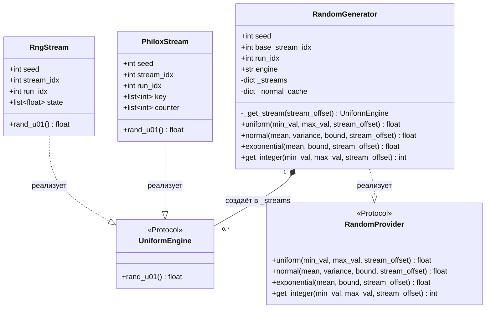
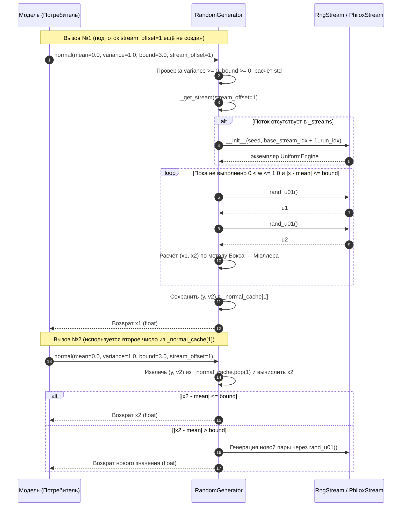
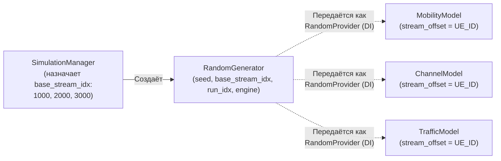

# Диаграммы модуля RNG

> Ответственный: Шаимов Богдан | Проверено по коду: `RNG.py` (v2.0.0)

## 1. Структура классов и контрактов модуля (`RNG.py` v2.0.0)

Фасад `RandomGenerator` реализует внешний контракт `RandomProvider` и создаёт подпотоки через внутренний контракт `UniformEngine` по выбранной стратегии из словаря `_ENGINES`.

## 2. Сценарий вызова `RandomGenerator.normal()`

Показаны ленивая инициализация подпотока `stream_offset` и работа кэша пары чисел Бокса — Мюллера `_normal_cache`.

## 3. Схема целевой интеграции с `SimulationManager` и моделями (TO-BE)

## 4. Ссылки на исходники

- `RNG.py::UniformEngine`, `RNG.py::RandomProvider` — протоколы модуля.
- `RNG.py::RngStream` — ядро `MRG32k3a` (`_build_cache`, `_advance_nth_by`, `rand_u01`).
- `RNG.py::PhiloxStream` — ядро `Philox4x64` (`_philox_round`, `_mulhilo`, `rand_u01`).
- `RNG.py::RandomGenerator` — фасад распределений (`_get_stream`, `uniform`, `normal`, `exponential`, `get_integer`).