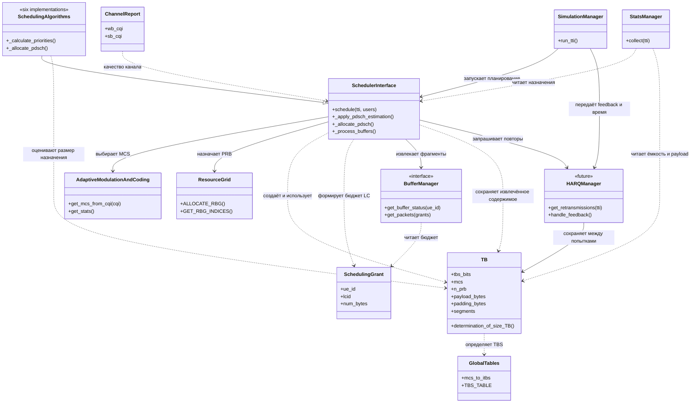

# Спецификация по ТБ
>Ответственный: Влад
>Состояние: обсуждается
>Написано по коду: `dev@`ae9db40 | Обновлено: `2026-10-21`
## Транспортный блок
**Краткое описание:** TB — объект одной передачи данных конкретному UE. Он хранит выбранные параметры MCS, число выделенных ресурсных блоков rb, размер tbs в битах и содержимое, извлечённое из очередей. При повторной передаче используется сохранённое содержимое этого же блока.

**Проблема:** Функции модуля SHEDULER.py рассчитывают размер данных в трех местах(_apply_pdsch_estimation, _allocate_pdsch, _process_buffers). Что плохо влиет на оптимизацию.

**Цель:** Создание единой контейнера между решением планировщиком и тем что уходит в эфир.

**Предлагаемые изменения:** внедрить @dataclass транспортного блока, определить методы для работы с ним. Так же из ns3 перенести перевод из CQI в MCS. 

**Как это повлияет на архитектуру:** рассчет размера блока будет проходить в одном месте, что повлиет на скорость выполнения программы, а также повысит читаемость кода. Так же это повлиет на все sheduler алгоритмы так как сейчас рассчет размера блока в них происходит из вместимости выделенных ресурсных блоков. Функции вне модуля SHEDULER никак не пострадают, так как поменяются только входные данные, а выход останется прежним.

**План реализации:**
  1. Подготовка таблиц TBS_TABLE, MCS_TO_I_TBS.
  2. Подготовка AdaptiveModulationAndConfig, добавление перевода CQI->MCS из ns3.
  3. Создание структуры TB.
  4. Подключить индекс MCS к расчёту TBS.
  5. Зафиксировать правила выбора MCS и обработки CQI=0.
  
**Предполагаемая реализация:**

@dataclass

class TransportBlock:

    ue_id: int
   
    tbs: int

    cqi: int

    rb: int

    buffer: list[int] = field(default_factory=list)

    ndi: int = 1

    rv: int = 0

    harq_id: int = 0   

    def determination_of_size_TB(self):

        if type(self.mcs) is not int or not 0 <= self.mcs <= 28:
            raise ValueError("MCS должен быть целым числом от 0 до 28")

        i_tbs = GLOBALS.mcs_to_itbs[self.mcs]
        row = GLOBALS.TBS_TABLE[i_tbs]

        if type(self.rb) is not int or not 1 <= self.rb <= len(row):
            raise ValueError(
                f"Число PRB должно быть целым числом от 1 до {len(row)}"
            )
        self.tbs = row[self.rb - 1]
        return self.tbs 
  
## Зависимости и изменения для внедрения транспортного блока

**Статус:** предложение, требует согласования.

### Основные контракты

- MCS определяется по согласованной политике CQI→MCS.
- TBS определяется по MCS и общему числу выделенных PRB.
- TBS хранится в битах, бюджет Buffer — в байтах.
- Все компоненты используют один способ расчёта TBS.
- Размер всего TB нельзя получать сложением независимых TBS отдельных RBG.
- При отсутствии выделенных ресурсов TB не создаётся.
- Содержимое TB и его номинальный размер учитываются отдельно.
- На этапе HARQ повтор использует сохранённое содержимое без нового извлечения данных из Buffer.

## Выбор MCS и расчёт TBS

Для одного TB выбирается один MCS на основе WB-CQI пользователя.

FD-планировщики используют SB-CQI для выбора получателя каждой
группы RBG. Окончательный TBS рассчитывается по выбранному WB-MCS
и общему числу выделенных ресурсных блоков `rb`.

При распределении ресурсов оценка оставшейся очереди согласуется
с табличным TBS по WB-MCS. SB-CQI используется для выбора получателя,
но не задаёт отдельный бюджет данных для каждого RBG.

После окончательного назначения MCS и TBS сохраняются в TB.
Обработка буфера и статистика используют эти значения без
независимого пересчёта.

## Взаимодействие с BufferManager

Планируется сохранить интерфейс `BufferManager.get_packets(grants)`.

Планировщик формирует гранты в пределах байтового бюджета TB.
BufferManager возвращает извлечённые пакеты или фрагменты и их
фактический объём. Полученные данные сохраняются в TB.

`SchedulingGrant` определяет бюджет извлечения для логического
канала. Один TB может наполняться по нескольким грантам.

Необходимо проверить:
- суммарное извлечение не превышает бюджет TB;
- возвращённые фрагменты соответствуют фактическому объёму данных;
- после извлечения определён владелец содержимого TB.

Отсутствие изменений внутри BufferManager заранее не гарантируется.

### 1. Изменения в SCHEDULER.py

| Компонент / функция | Что необходимо изменить | Зависимости и условия |
|---|---|---|
| `TB` | Добавить идентификатор UE либо хранить связь UE→TB снаружи. Различать номинальный размер, фактический payload и padding. | Формат фрагментов согласовать с Buffer. Текущий `buffer: list[int]` не определяет, как хранить возвращаемые объекты пакетов. |
| `TB.determination_of_size_TB()` | Сохранить проверки MCS/PRB и табличный расчёт. Сделать его единым источником TBS для остальных компонентов. Нулевое назначение обрабатывать до создания TB. | `GLOBALS.mcs_to_itbs`, `GLOBALS.TBS_TABLE`. Число PRB дополнительно ограничивается ресурсами станции. |
| `AdaptiveModulationAndCoding.get_mcs_from_cqi()` | Закрепить обработку CQI=0, допустимые типы и выбранные таблицы. Использовать результат при создании назначения TB. | Согласованный контракт CQI от Channel/UE. |
| `AdaptiveModulationAndCoding.GET_BITS_PER_RB()` | Перестать использовать как окончательный расчёт размера блока. При сохранении метода явно обозначить его как приблизительную оценку. | Нельзя заменить его на TBS одного PRB и затем умножать на количество PRB. |
| `SchedulerInterface.schedule()` | Организовать передачу выбранных MCS, PRB и TBS между этапами. После окончательного выделения создать TB и передать его на наполнение. | Все алгоритмы должны возвращать либо сохранять согласованные сведения о назначении. |
| `SchedulerInterface._apply_pdsch_estimation()` | Вместо деления размера очереди на bits/RB определять потребное число PRB по табличному TBS. Учитывать размеры RBG и доступную полосу. | Общий расчёт TBS; размер очереди; политика выбора MCS. Это предварительная оценка, а не извлечение данных. |
| `BestCQIScheduler._allocate_pdsch()` | При добавлении RBG оценивать ёмкость суммарного назначения UE. Обновлять оценку оставшейся очереди относительно общего TBS. | Выбранный MCS и число уже назначенных PRB. |
| `ProportionalFairScheduler._allocate_pdsch()` | Аналогично перейти от суммы формульных ёмкостей RBG к ёмкости всего назначения. | Общий расчёт TBS и PF-порядок обслуживания. |
| `RoundRobinScheduler._allocate_pdsch()` | Сохранить циклический порядок, но уменьшать временную очередь по приросту ёмкости общего назначения. Следить за переводом битов в байты. | Состояние назначения каждого UE и общий расчёт TBS. |
| `FDxBestCQIScheduler._allocate_pdsch()` | Определить единый MCS для TB и согласовать его с выбором RBG по SB-CQI. Перед назначением оценивать новый общий TBS. | Правило объединения WB/SB-CQI требует согласования. |
| `FDxFairGreedyScheduler._allocate_pdsch()` | Сохранить обслуживание раундами, но учитывать ёмкость общего TB после добавления группы. | Те же правила выбора MCS, что и у других FD-алгоритмов. |
| `FDxProportionalFairScheduler._allocate_pdsch()` | Отделить локальную PF-метрику выбора RBG от точного бюджета общего TB. Проверять влияние добавленного RBG на общий MCS/TBS. | При изменении MCS добавление группы может уменьшить общую ёмкость; это нужно обработать явно. |
| `ProportionalFairScheduler._calculate_priorities()` | Потенциальный объём за TTI оценивать по табличному TBS принятого назначения, например всей доступной полосы, вместо `число PRB × bits_per_rb`. | Средняя и потенциальная скорости должны иметь согласованные единицы. |
| `FDxProportionalFairScheduler._calculate_priorities()` | Аналогично обновить предварительную WB-PF оценку, используемую для порядка кандидатов. | Эта оценка не заменяет окончательный TBS по реально выделенным ресурсам. |
| `SchedulerInterface._process_buffers()` | Принимать подготовленный TB или сведения о нём. Использовать сохранённый TBS вместо нового расчёта по WB-CQI. Извлекать данные в пределах байтового бюджета и сохранять возвращённые фрагменты в TB. Убрать прибавление `remainder_bits` к payload. | BufferManager, SchedulingGrant, выбранные MCS/TBS. |
| `SchedulerInterface._logical_channel_multiplexing()` | Передавать явно определённый бюджет данных в байтах. Не рассчитывать MCS/TBS внутри мультиплексора. Учитывать неиспользованный бюджет как padding либо перераспределять по согласованной политике. | Состояния логических каналов и модель overhead. |
| `SchedulingGrant` | Сохранить роль указания Buffer: UE, LCID и число извлекаемых байт. Не использовать его как замену объекту TB. | Существующий интерфейс `BufferManager.get_packets(grants)`. |
| `AdaptiveModulationAndCoding.get_stats()` | Получать номинальную ёмкость из сохранённого TBS. Отдельно учитывать фактический payload и заполнение. | Данные последнего назначения и TB. |
| `SchedulerInterface._build_result()` | Определить, нужны ли сведения о TB во внешнем результате. При добавлении новых полей сохранить существующие `allocation`, `bitmap` и `pdcch_stats`. | Совместимость с вызывающим кодом требует проверки. |
| `SchedulerInterface._empty_result()` | Очищать сведения о TB текущего шага, если они добавлены в состояние планировщика. | Не допускать выдачи статистики предыдущего TB как текущей. |

### 2. Зависимости от соседних модулей

| Модуль / объект | Требуемое действие | Характер зависимости |
|---|---|---|
| `GLOBALS.py::mcs_to_itbs` | Проверить соответствие выбранному LTE DL-профилю и диапазону MCS. | Таблица уже существует; требуется проверка. |
| `GLOBALS.py::TBS_TABLE` | Проверить значения, ориентацию строк/столбцов, диапазон PRB и единицы. | Таблица уже существует; наличие массива не доказывает корректность всех элементов. |
| `BS_MODULE.py::SimpleBufferManager.get_packets()` | Проверить соблюдение бюджета и соответствие возвращаемых пакетов фактическому числу байт. | При сохранении грантов в байтах изменение интерфейса может не потребоваться. |
| `BS_MODULE.py::LayeredBufferManager.get_packets()` | Проверить извлечение по LCID, фрагментацию и суммарный бюджет. | Требуется согласование представления содержимого TB. |
| `RES_GRID.py::RES_GRID_LTE` | Использовать число частотных PRB за TTI без повторного удвоения по слотам. Проверять успешность назначения до извлечения данных. | Изменение интерфейса не обязательно; требуется интеграционная проверка. |
| `CHANNEL_MODEL.py` и `UE_MODULE.py` | Подтвердить формат WB/SB-CQI и политику выбора MCS. | Для первого этапа можно использовать существующую отчётность. |
| `SIMULATION_MANAGER.py::SimulationManager.run_tti()` | Проверить совместимость вызова Scheduler и результата. | Изменение исходников зависит от выбранного внешнего контракта TB. |
| `SIMULATION_MANAGER.py::StatsManager.collect()` | Проверить смысл и единицы показателей после перехода на табличный TBS. | Даже при сохранении названий значения метрик могут измениться. |
| `TEST_MODULES.py` и тесты планировщиков/буферов | Обновить ожидания, добавить табличные контрольные значения и проверки бюджета. | Старые численные ожидания основаны на прежней модели вместимости. |

### 3. UML предполагаемых зависимостей — TO-BE

Диаграмма отражает предложение. Интерфейсы и дополнительные поля требуют
согласования. Связи показывают использование объектов, а не обязательные
импорты Python.

### 4. Условия согласованности

1. Окончательный MCS не выбирается повторно при обработке Buffer.
2. Все оценки TBS используют одну реализацию табличного расчёта.
3. На предварительных этапах допустимы расчёты для разных кандидатных
   назначений: это не означает, что размер можно вычислить один раз
   до распределения ресурсов.
4. TB создаётся для успешного окончательного назначения.
5. Фактический payload не превышает доступный байтовый бюджет.
6. Неиспользованный бюджет не считается переданными данными приложения.
7. При HARQ повтор использует сохранённые данные, а не следующую
   порцию из очереди.
  
  
  
  
  
  
  
  
  
  
  
  
  
  