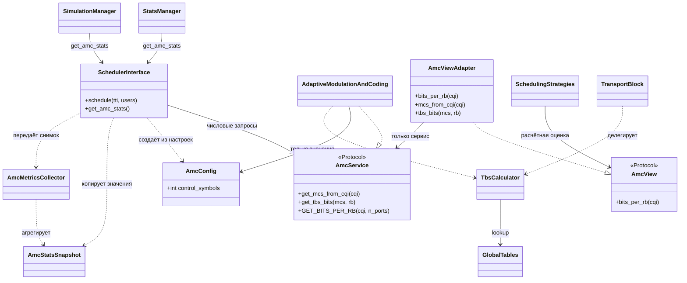

# SPEC-FEAT-AMC-001 — Самостоятельный AMC: TBS, интерфейс и отделение статистики

> Актуализация 2026-11-01: [исправления по ревью AMC](AMC_REVIEW_FIXES.md) имеют приоритет над прежними предложениями ниже. Legacy-статистика и конструктор сохранены; TB вынесен в TRANSPORT_BLOCK.py, TBS исправлен на 88 в I_TBS=6/N_PRB=1, добавлен интерфейс политики MCS. AMC_METRICS и удаление get_stats сейчас не планируются.

> Ответственный: Влад.  
> Статус: механический перенос выполнен; самостоятельность AMC проектируется.  
> Обновлено: 2026-10-30. Проверено по локальным исходникам; 
> Связанные материалы: [features.md](features.md), [FEAT-TB-001](FEAT-TB-001.md), [audit.md](audit.md), [диаграммы](diagrams.md#вынос-amc-из-schedulerpy).

## 1. Цель

Отделить адаптацию параметров передачи и расчёт размера транспортного блока от логики распределения радиоресурсов.

Сделать существующий `PyScheduler/AMC.py` самостоятельным: он получает явные числовые входы и конфигурацию, возвращает MCS, TBS или оценку вместимости и не хранит объект Scheduler. В расширенном плане первым функциональным этапом A1 остаётся табличный расчёт TBS. Он не является условием устранения обратной зависимости AMC от Scheduler. Статистика выводится из AMC в отдельный компонент, работающий по снимку данных.

Фактически выполнен только механический перенос класса и таблиц эффективности в AMC.py с сохранением интерфейса. Конструктор по-прежнему принимает Scheduler, get_stats остаётся в AMC. TransportBlock и его расчёт находятся в SCHEDULER.py. Это промежуточное состояние; описанные ниже AmcConfig, get_amc_stats и AMC_METRICS ещё не реализованы.

После переноса прошли 69 тестов текущего поведения. AST-сравнение подтвердило неизменность тела класса и остального кода Scheduler, кроме импорта. Полная интеграционная регрессия не подтверждена.

## 2. Объём и правила миграции

**Входит:**

- Первый этап: единый расчёт MCS→I_TBS→TBS в AMC и делегирование ему существующего метода TransportBlock.
- Выбор MCS по CQI и формульная оценка bits/RB как разные операции с разными контрактами.
- Явная конфигурация AMC без ссылок на Scheduler/PDCCH/UE/Buffer.
- Отделение `get_stats()` от AMC и переход потребителей на отдельный интерфейс статистики.
- Перенос класса AMC, двух таблиц эффективности и TransportBlock; совместимые импорты имён там, где это возможно.
- Адаптер к предложенному Тимуром `AmcView` и обязательная регрессия после каждого этапа.

**Не входит:**

- ACK/NACK, HARQ manager, модель ошибок и наполнение TB.
- Одновременное переключение всех алгоритмов с прежней формулы на табличный бюджет.
- Перестройка BufferManager, ресурсной сетки.

**Граница первого этапа TBS:** это рабочий сервис расчёта с проверками и подключённый к нему `TransportBlock.determination_of_size_TB()`, а не только описание будущего метода. Переключение фактического бюджета `_process_buffers()` и аллокаторов — отдельный согласованный семантический шаг FEAT-TB-001. Оба события должны различаться в отчёте: «табличный расчёт готов» не означает «вся передача использует TBS».

**Правила каждого этапа:**

1. Каждый этап заканчивается работающим состоянием проекта, проверкой нового контракта и регрессией затронутых путей.
2. Архитектурные этапы сохраняют прежние вычислительные результаты; изменение сигнатуры статистики выполняется вместе с обновлением всех её известных потребителей.
3. Известные отклонения таблиц не исправляются попутно.
4. Каждый этап имеет отдельный откат. Следующий этап не начинается при необъяснённом расхождении регрессии.
5. Временные зависимости старого пути допустимы только до указанного этапа их удаления; в целевой архитектуре ссылки AMC→Scheduler нет.

## 3. AS-IS: что подтверждено кодом

| Объект | Сейчас | Почему требуется изменение |
|---|---|---|
| `SchedulerInterface.__init__()` | `self.amc = AdaptiveModulationAndCoding(self)` | AMC получает весь объект планировщика. |
| `GET_BITS_PER_RB()` | Читает `self.scheduler.pdcch_manager.pcfich`. | Численный расчёт зависит от структуры чужого компонента. |
| `get_stats()` внутри AMC | Читает `_last_users`, `_last_allocation`, `cqi_map`, поля UE. | AMC одновременно считает параметры передачи и собирает состояние системы. |
| `get_mcs_from_cqi()` | Выбирает индекс MCS по двум таблицам эффективности. | Метод уже существует; перенос из ns-3 заново не требуется. |
| `CQI_TO_MCS` | Возвращает пару Qm/code rate для формульной оценки. | Не является индексной таблицей MCS и не заменяет цепочку TBS. |
| `TransportBlock.determination_of_size_TB()` | Проверяет MCS/PRB и читает таблицы GLOBALS. | Существующий расчёт следует централизовать, а не копировать в AMC. |
| `StatsManager.collect()` и цикл `start_simulation()` | Вызывают `scheduler.amc.get_stats()`. | Оба потребителя должны перейти на новый источник статистики. |

Источники: [AMC.py](../PyScheduler/AMC.py), [SCHEDULER.py](../PyScheduler/SCHEDULER.py), [SIMULATION_MANAGER.py](../PyScheduler/SIMULATION_MANAGER.py), [GLOBALS.py](../PyScheduler/GLOBALS.py).

Локально проверены шесть алгоритмов. Приложенная спецификация Тимура описывает восемь алгоритмов и другую базу кода; её список и результаты тестов не считаются подтверждением локальной реализации.

## 4. Целевой интерфейс Scheduler ↔ AMC

Все имена новых методов и типов ниже — **предложение контракта**, а не существующее API. Формализация — `typing.Protocol` для интерфейса и неизменяемый dataclass для конфигурации/снимков. Финальные имена требуется согласовать с Тимуром.

### 4.1 Конфигурация AmcConfig

| Поле | Тип / значение | Смысл |
|---|---|---|
| `control_symbols` | `int`, исходное значение 2 | Значение, которое legacy-формула получала из `pcfich`; это число символов управляющей области, не объект PDCCH. |

Проверку допустимости сочетания полосы и управляющей области выполняет внешний код конфигурации, как сейчас PDCCHManager. AMC не обращается к нему. На этапе совместимого переноса не вводятся дополнительные ограничения формулы и новые правила для числа портов.

Конструктор: `AdaptiveModulationAndCoding(config: AmcConfig)`; конфигурация не содержит объектов, callback-функций или замыканий на Scheduler. Отсутствие конфигурации может использовать `AmcConfig(control_symbols=2)` как явно документированное значение по умолчанию.

При изменении конфигурации создаётся новый экземпляр AMC и обновляется ссылка адаптера; прежняя конфигурация не меняется скрыто. Статический и обновлённый сценарии проверяются отдельно. Для первой интеграции допустима неизменная конфигурация на один прогон.

### 4.2 Вычислительный контракт AmcService

| Операция | Вход | Выход / ошибки |
|---|---|---|
| `get_mcs_from_cqi(cqi)` | CQI | Индекс MCS по существующим таблицам. Legacy-поведение CQI=0 → MCS=0 сохраняется до отдельного изменения. |
| `get_tbs_bits(mcs, rb)` | Целые MCS 0–28 и число PRB 1–110 для выбранного профиля | Положительный размер TB в битах; недопустимые типы, включая bool, и диапазоны → ValueError. |
| `GET_BITS_PER_RB(cqi, n_ports=1)` | CQI, число портов и сохранённая конфигурация | Прежняя приблизительная оценка бит на пару RB за TTI; типы результатов и существующие исключения сохраняются. |

Сервис не знает UE ID, распределение RBG, очереди, текущий TTI и историю скорости. Число доступных PRB в полосе проверяет Scheduler; ширина таблицы 110 сама по себе не разрешает назначать 110 PRB в любой полосе.

В классе нет `self.scheduler` и нет метода, который сам читает статистику сети. Недопустимы и скрытые эквиваленты: передача PDCCHManager вместо Scheduler или callback, возвращающий внутреннее состояние Scheduler.

### 4.3 Совместимость с AmcView Тимура

В приложенной SPEC-FEAT-SCH-008 v4, §5.4, определён `AmcView.bits_per_rb(cqi) -> int`. Предлагается тонкий `AmcViewAdapter`, который хранит только ссылку на AmcService:

| Интерфейс стратегий | Делегирование | Статус |
|---|---|---|
| `bits_per_rb(cqi)` | `service.GET_BITS_PER_RB(cqi)` | Соответствует документированному шву Тимура; подтвердить актуальные имена в разработке. |
| `mcs_from_cqi(cqi)` | `service.get_mcs_from_cqi(cqi)` | Предлагаемое расширение, ещё не согласовано. |
| `tbs_bits(mcs, rb)` | `service.get_tbs_bits(mcs, rb)` | Предлагаемое расширение для будущего TBS-aware пути, ещё не согласовано. |

Адаптер ничего не выбирает и не меняет сетку. Самостоятельный AMC не импортирует определения стратегий; владельцем адаптера является интеграционный слой Scheduler. Существующие прямые вызовы `self.amc.GET_BITS_PER_RB()` работают с самостоятельным сервисом до миграции стратегий.

## 5. Первый этап: TBS и TransportBlock

### 5.1 Табличный контракт

Для базового пользователя:

1. `i_tbs = GLOBALS.mcs_to_itbs[mcs]`.
2. `tbs_bits = GLOBALS.TBS_TABLE[i_tbs][rb - 1]`.
3. Вернуть целое значение в битах; не умножать его дополнительно на PRB или число слотов.

`GLOBALS` остаётся местом хранения данных таблиц. В начале этапа проверяются длина отображения, наличие строк I_TBS и ширина 110 столбцов. Происхождение таблиц и выбранная редакция стандарта должны быть указаны в отчёте; структурная проверка не доказывает правильность всех ячеек.

Реализационный шаг A1 может сначала добавить чистую функцию `get_tbs_bits(mcs, rb)` в существующий AMC.py. Позднее одноимённый метод AmcService делегирует ей. Это один алгоритм расчёта, а не две расходящиеся реализации.

### 5.2 Связь с TransportBlock

`TransportBlock.determination_of_size_TB()` делегирует единому расчёту, сохраняет результат в `self.tbs` и возвращает его. До переноса класса он остаётся в Scheduler; конечное размещение — в AMC.py вместе с существующими полями. Класс не получает Scheduler или PDCCHManager.

Сохраняются `ue_id`, `tbs`, `mcs`, `rb`, `buffer`, `ndi`, `rv`, `harq_id`. `rb` — количество выделенных ресурсных блоков, не список индексов. Перенос не вводит автоматическое наполнение буфера, управление RV или ACK/NACK.

### 5.3 WB/SB и дальнейшее подключение

Ранее принятое решение сохраняется: MCS итогового TB выбирается по WB-CQI; SB-CQI используется FD-стратегиями для выбора получателя RBG. В TBS-aware пути оценка всего назначения, бюджет Buffer и статистика используют один сохранённый WB-MCS/TBS.

В текущем legacy-пути FD-оценки продолжают работать по существующей формуле. Их переключение на точный TBS должно быть отдельным явно согласованным изменением, поскольку меняет значения и потенциально распределение. Нельзя требовать одновременно полного совпадения legacy-назначений и незаметного перехода на другую модель ёмкости.

Нельзя складывать TBS отдельных RBG. Для фиксированного MCS прирост определяется как TBS нового общего числа PRB минус TBS прежнего общего числа PRB; для нулевого назначения ёмкость 0 задаётся снаружи без чтения столбца `-1`.

## 6. Статистика без обратной зависимости

### 6.1 Предлагаемые типы данных

Новый `AMC_METRICS.py` содержит только типы снимка и функцию `collect_amc_stats(snapshot) -> dict`. Она не импортирует Scheduler, UE, PDCCH, Buffer или SimulationManager и не получает ссылки на их объекты.

| Поле записи AmcUeStatsInput | Тип / единицы | Источник при построении снимка |
|---|---|---|
| `ue_id` | int | Идентификатор UE, прошедшего прежние правила включения в статистику. |
| `allocated_rb` | int | Длина назначения частотных PRB. |
| `capacity_bits` | int, биты за TTI | Явно рассчитанная ёмкость принятого назначения. Пока legacy: bits/RB × PRB; в будущем TBS-aware пути: сохранённый TBS. |
| `transmitted_bits` | int, биты за TTI | Учтённое значение UE; это не подтверждённая ACK доставка. |
| `throughput_bps` | float, бит/с | Текущая скорость UE. |
| `wb_cqi` | int или None | None означает отсутствие записи; числовое значение для старых средних воспроизводится сборщиком по прежнему правилу. |
| `sb_cqi` | tuple[int, ...] | Копия доступного SB-отчёта; при отсутствии — пустой tuple. |
| `sinr_db` | float или None | Значение либо отсутствие измерения. |

`AmcStatsSnapshot` содержит `tti: int | None`, признак готовности `ready: bool` и `records: tuple[AmcUeStatsInput, ...]`. `ready=False` означает отсутствие завершённого шага; результат определяется явно, а не чтением неинициализированных полей Scheduler. Пустой завершённый шаг (`ready=True`, records пусты) отличим от отсутствия шага.

Снимок создаёт внешний сборщик у владельца состояния — `SchedulerInterface.get_amc_stats()` или его небольшой локальный helper. Он копирует примитивные значения, воспроизводит прежнюю фильтрацию/порядок и рассчитывает legacy-capacity через независимый AMC. Снимок не содержит словари с объектами UE или ссылки на живые CQI-записи. Он строится при запросе статистики, в тот же момент, когда раньше читались эти поля, чтобы не менять временную семантику сбора.

### 6.2 Обновление потребителей

`StatsManager.collect()` и вывод текущих показателей в `SimulationManager.start_simulation()` переходят с `scheduler.amc.get_stats()` на предлагаемый `scheduler.get_amc_stats()` в одном рабочем этапе A2.

`get_amc_stats()` формирует снимок и вызывает независимый сборщик. Схема экспортируемых показателей, единицы и округления сохраняются для уже завершённых состояний. Существующие различия пустых ветвей фиксируются baseline-тестами, а не сглаживаются попутно. Только для неготового состояния вводится явно описанный `ready=False`; если исходный вызов падал, это отдельное разрешённое изменение контракта с собственным тестом.

Метод `get_stats()` в самостоятельном AMC отсутствует. Сохранение прежнего способа вызова не используется как причина оставить скрытый доступ AMC→Scheduler. Изменение публичного источника статистики согласуется с владельцем SimulationManager; не найденные внешние потребители должны быть перечислены до удаления старого метода.

Не переносить в сборщик ссылки на внутренности через конструктор: его самостоятельность проверяется обычными числовыми записями без создания сети.

## 7. Ответственность и зависимости

| Компонент | Действие / ответственность | Чего он не делает |
|---|---|---|
| `AMC.py` | CQI→MCS, tabular TBS, legacy bits/RB; конфигурация значениями. | Не читает Scheduler/PDCCH/UE и не собирает состояние сети. |
| `TransportBlock` | Параметры и результат TBS; делегирование одному расчёту. | Не планирует ресурсы и не реализует HARQ. |
| `SchedulerInterface.__init__()` | После создания PDCCHManager копирует pcfich в AmcConfig, затем создаёт независимый сервис. | Не передаёт `self` внутрь AMC. |
| `_apply_pdsch_estimation()`, `_allocate_pdsch()`, PF-приоритеты, `_process_buffers()` | Используют сервис или AmcView; до семантической миграции формулы legacy прежние. | Не получают доступ к состоянию AMC через Scheduler-ссылку. |
| `SchedulerInterface.get_amc_stats()` — новый | Собирает примитивный снимок в момент запроса и передаёт его сборщику. | Не хранит статистические обязанности внутри AMC. |
| `AMC_METRICS.py` — новый | Чистая агрегация снимка с прежними показателями. | Не импортирует компоненты сети. |
| `StatsManager.collect()`, `start_simulation()` | Используют новый источник статистики. | Не требуют, чтобы AMC владел сетью. |
| `GLOBALS.py` | Сохраняет таблицы данных; структурная проверка при запуске расчётного сервиса. | Не импортирует AMC/Scheduler. |
| BufferManager, Channel, RES_GRID | Существующие контракты сохраняются; изменения для следующих TBS/HARQ этапов согласуются отдельно. | Не перестраиваются ради выделения AMC. |

Совместимые импорты `AdaptiveModulationAndCoding`, `TransportBlock` и двух констант через `SCHEDULER.py` сохраняются после финального переноса. Совместимость конструктора с аргументом Scheduler и старого `amc.get_stats()` намеренно не обещается: эти связи устраняются. Места использования обновляются атомарно. Pickle и проверки `__module__` требуют отдельной инвентаризации.

## 8. Согласование с Тимуром

Приложенный SPEC-FEAT-SCH-008 v4 от 2026-10-23 изучен как описание планируемых интерфейсов другой ветки. Факт их реализации в локальной копии не установлен. Самостоятельная отправка сообщений Тимуру не выполнялась; согласование не объявляется состоявшимся.

| Вопрос | Предложение AMC | Статус |
|---|---|---|
| Вход существующих стратегий | Сохранить `AmcView.bits_per_rb(cqi)` и предоставить адаптер. | Сверено с §5.4 документа, подтвердить фактический API разработки. |
| TBS-расширение | `mcs_from_cqi` и `tbs_bits` как методы view; один MCS по WB для итогового TB. | Требуется согласование. |
| Конфигурация | Передавать `control_symbols` значением; никаких ссылок Scheduler/PDCCH в AMC. | Предложение по замечанию куратора. |
| Статистика | Новый `get_amc_stats()` у владельца состояния, сборщик по снимку. | Согласовать с Тимуром и владельцем SimulationManager. |
| `AllocationResult` | Использовать `ue_prbs` для подсчёта rb. Не менять и не отбрасывать `flow_budget_bits`. | Согласовать адаптацию после изменения аллокатора. |
| `MultiplexingPolicy` | Не изменять интерфейс и QoS-гранты в архитектурных шагах. TBS-aware бюджет — отдельная миграция. | Требуется согласование с владельцем QoS. |
| Порядок слияния | Сначала baseline и A1, далее общий статистический шов и конфигурация, затем потребители view. | SHA и реальные PR предстоит определить. |

Эти вопросы не мешают готовить baseline, табличный расчёт и локальные unit-тесты. PR, меняющий общий интерфейс, должен ссылаться на подтверждённую договорённость. Условия запуска работы из документа коллеги не переносятся автоматически как запрет на всю разработку AMC.

## 9. План: обязательная регрессия после каждого этапа

Механический перенос уже выполнен отдельным предварительным шагом E0. A0 частично готов: 69 тестов проходят, полный baseline симуляции не завершён. A1–A5 остаются планом; A1 — расширение TBS. Для самостоятельности вычислений обязательны A2/A3, а TBS — отдельная функциональная задача в составе этой спецификации.

| Этап | Изменение | Обязательная приёмка до следующего этапа | Откат |
|---|---|---|---|
| A0 | Снять численные эталоны и короткий детерминированный сценарий. | Самопроверка baseline: два одинаковых запуска, явно сохранённые входы/выходы и исключения. Ничего в runtime не меняется. | Удалить только добавленные материалы baseline. |
| A1 | Реализовать чистый TBS в AMC.py и делегировать ему расчёт существующего TB. | Unit: контрольные ячейки, диапазоны, типы, 3190 допустимых сочетаний. Регрессия TB и всех legacy-назначений против A0; штатный интеграционный сценарий. | Вернуть прежний расчёт TB, удалить ещё не используемый сервис. |
| A2 | Добавить числовой снимок, независимый AMC_METRICS и get_amc_stats; одновременно перевести обоих известных потребителей. AMC уже находится в отдельном файле, но пока сохраняет старый интерфейс. | Unit снимка/агрегации, пустой и неготовый шаг; регрессия всех ключей/значений статистики и legacy-назначений. Отличие неготового состояния выделено отдельным тестом. | Откатить вместе сборщик и вызовы потребителей. |
| A3 | В существующем AMC.py передать AmcConfig, удалить self.scheduler и старый get_stats; перенести TB с совместимым импортом. | Unit конфигурации/импортов; численное совпадение AMC/TB и регрессия сценариев A0. Статический поиск запрещённых зависимостей. Проверка обновлённой конфигурации. | Откатить перенос и конструктор единым шагом; A1/A2 остаются рабочими. |
| A4 | Подключить согласованный AmcViewAdapter к фактически готовым стратегиям Тимура. | Contract-тест view; unit адаптера; регрессия каждого реально затронутого алгоритма отдельно, WB и SB, бюджеты потоков при наличии QoS. Не ждать миграции всех стратегий для проверки первой. | Вернуть конкретному потребителю прежний прямой вызов независимого сервиса. |
| A5 | Зафиксировать итоговую совместимость, обновить размещение в README и инвентаризацию вызовов. | Повторить R-батарею целиком; unit + интеграция; старые импорты, отсутствие amc.get_stats и Scheduler-ссылок; отчёт о каждом этапе. | Откатить только заключительные изменения; не возвращать запрещённую связь в целевую архитектуру. |

Если A2 или A3 оказывается слишком большим для одного самостоятельного PR, он разбивается на подэтапы с собственной регрессией; общая правка вызова и его реализации должна оставаться рабочей в каждом промежуточном состоянии. Оценки трудоёмкости не назначены.

### 9.1 Общая R-батарея для A1–A5

- **R-TBS:** фиксированные контрольные размеры, исключения, повторный расчёт, независимость содержимого TB.
- **R-AMC:** выбор MCS для CQI 0–15, bits/RB для CQI 1–15, разные управляющие области и число портов; сравнение с сохранённым A0.
- **R-SCHED:** одинаковые назначения PRB/CCE, очереди до/после, извлечённые байты, throughput, EWMA и RR offsets; для FD — контрастные SB/WB. При интеграции QoS — также per-flow бюджеты и гранты.
- **R-STATS:** сравнение схемы и значений всех метрик завершённого шага; отдельные тесты пустого/неготового состояния и момента запроса.
- **R-INTEGRATION:** существующий `sim_with_manager_qos()` на 5000 TTI до/после с одинаковыми входными потоками случайности. Сравниваются не времена выполнения, а расчётные результаты и схема файлов.

Название seed само по себе не гарантирует одинаковые случайные входы. Для строгого сравнения сохраняются последовательности входных данных либо изолируются генераторы; исключения из сравнения перечисляются явно. Сломанный исторический набор не считается зелёной регрессией: нужны воспроизводимые characterization-проверки.

После **каждого** этапа отчёт содержит базу сравнения (SHA или хеш файлов), команду, PASS/FAIL, допустимые изменения, полученные различия и способ отката. Никакой этап не принимается только по финальному прогону всей миграции.

## 10. Контрольные значения и границы

| Проверка | Ожидание |
|---|---|
| MCS=0, rb=1 | 16 бит |
| MCS=18, rb=10 | 3240 бит = 405 байт |
| MCS=28, rb=10 | 7480 бит |
| MCS вне 0–28; rb=0/111; bool/float вместо целых в TBS | ValueError, состояние TB не изменено. |
| get_mcs_from_cqi(0/1/10/15) | Сохранённый legacy-результат 0/0/18/28. |
| GET_BITS_PER_RB(1/10/15), control_symbols=2, n_ports=1 | 41/530/798 бит. |
| I_TBS=6, rb=1 | 328 бит для текущей таблицы; не заменять на 88 без отдельного решения о профиле. |

Численные значения проверялись ранее на локальном коде. Полная верификация таблицы по источнику не завершена. Немонотонность известной ячейки не является доказательством ошибки индексации и не исправляется автоматически.

CQI=0 не используется как разрешение новой передачи: отбор остаётся обязанностью Scheduler. При отсутствии PRB блок не создаётся. Сохраняется различие между объёмом TB, payload и учтёнными переданными битами; появление TBS не означает наличие подтверждённой доставки.

## 11. UML целевых зависимостей

Новые сущности — предложение. Главный инвариант: **нет стрелки AMC → Scheduler**, ни импортом, ни ссылкой на объект.

`TbsCalculator` и `AmcMetricsCollector` — обозначения функций расчёта/агрегации, не требование создавать дополнительные классы. Методы расширения TBS в адаптере пока не являются согласованной частью AmcView Тимура.

## Связанные материалы

- [features.md](features.md).
- [FEAT-TB-001](FEAT-TB-001.md).
- [README AMC/HARQ](Readme.md).
- [Ревизия](audit.md).
- Приложенный `SPEC-FEAT-SCH-008.md`, v4, 2026-10-23, §5.3–5.4 и правила R1–R8: источник требований к интеграционному шву, не доказательство наличия интерфейсов в локальной копии.
