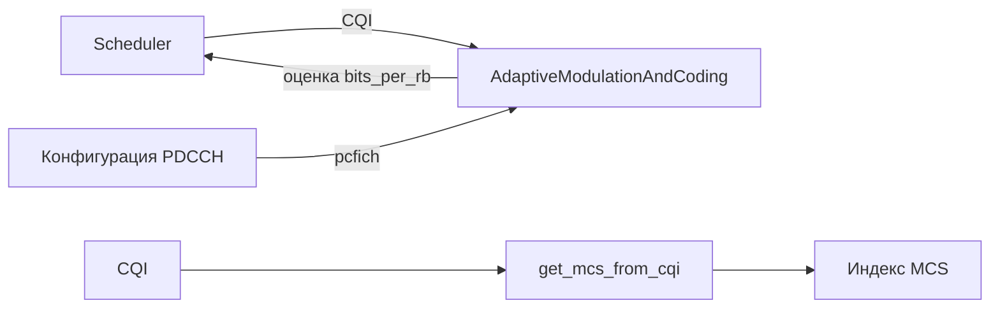
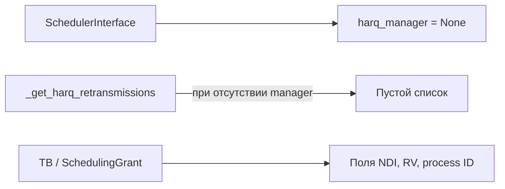
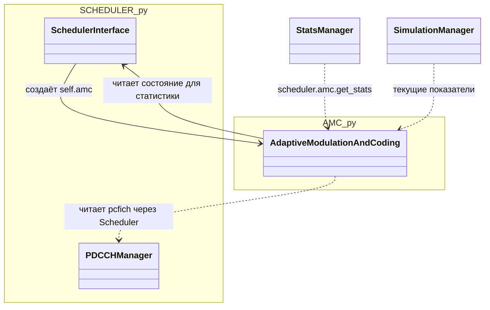
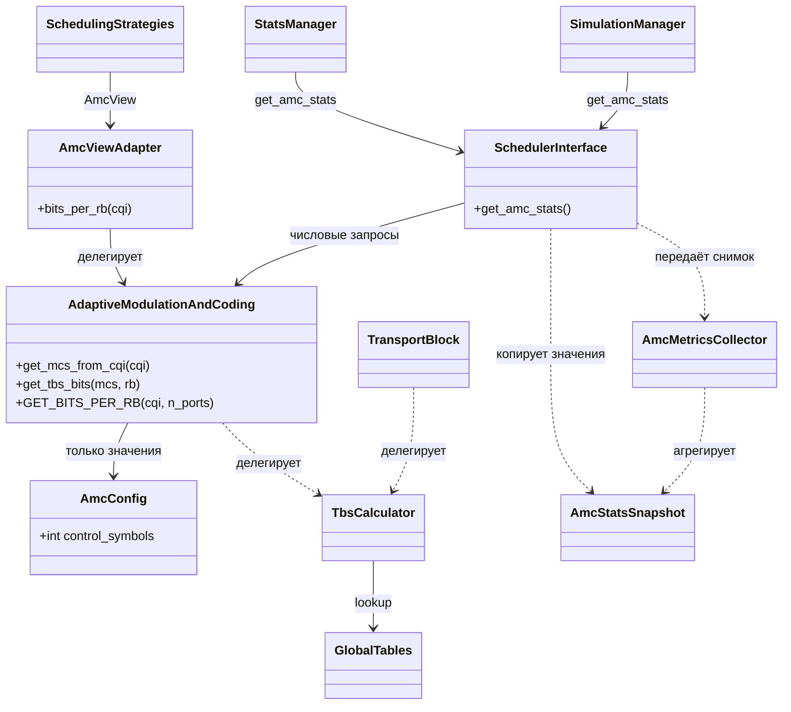

## Для AMC:

> Актуализация 2026-11-01: [исправления по ревью AMC](AMC_REVIEW_FIXES.md) имеют приоритет над прежними предложениями ниже. Legacy-статистика и конструктор сохранены; TB вынесен в TRANSPORT_BLOCK.py, TBS исправлен на 88 в I_TBS=6/N_PRB=1, добавлен интерфейс политики MCS. AMC_METRICS и удаление get_stats сейчас не планируются.

## Для HARQ:    

## Вынос AMC из SCHEDULER.py

Статус: TO-BE обсуждается. Основание: [SPEC-FEAT-AMC-001](SPEC-FEAT-AMC-001.md).
Класс и таблицы уже перенесены в AMC.py, прежняя связь с Scheduler сохранена. `AdaptiveModulationAndConfig`
в обсуждениях соответствует существующему `AdaptiveModulationAndCoding`.

### Текущее размещение — AS-IS

### Самостоятельный AMC — TO-BE v2

Прежняя схема с чтением Scheduler внутри AMC отменена по замечанию куратора.
Ниже целевая граница; интерфейсы пока не реализованы и требуют согласования.

В целевой реализации AMC не содержит Scheduler, PDCCHManager, UE или callback на их состояние. Сейчас ссылка на Scheduler ещё существует.
Статистика формируется снаружи по снимку примитивных данных. TbsCalculator и AmcMetricsCollector обозначают функции, не обязательные классы реализации.
AmcViewAdapter принадлежит интеграционному слою, его TBS-расширение нужно обсуждать с Тимуром. Детали контрактов, первого этапа TBS и регрессии после каждого шага:
[SPEC-FEAT-AMC-001](SPEC-FEAT-AMC-001.md).

Основания AS-IS: SCHEDULER.py::SchedulerInterface.__init__,
AMC.py::AdaptiveModulationAndCoding.GET_BITS_PER_RB/get_stats;
SIMULATION_MANAGER.py::StatsManager.collect/SimulationManager.start_simulation.
