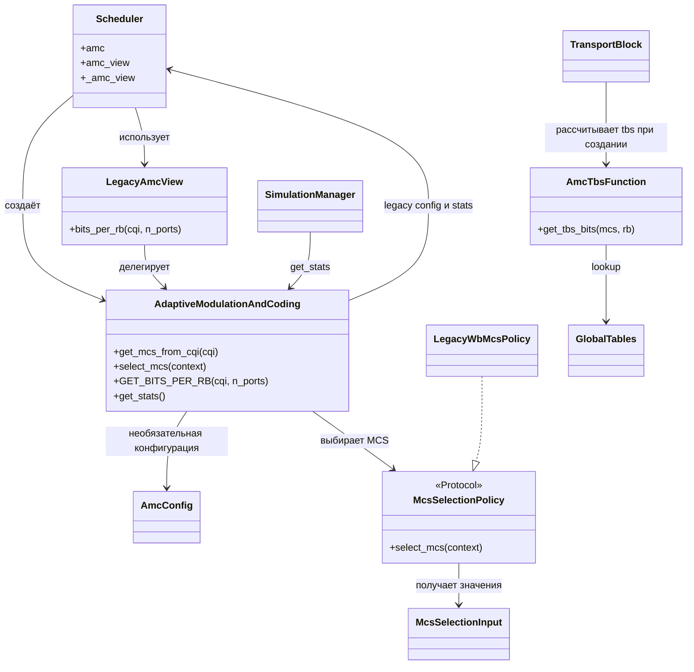

# Спецификация модуля AMC

> Ответственный: Влад.  
> Состояние: AMC вынесен в отдельный модуль; legacy-интерфейсы сохранены; табличный TBS готов, подключение к рабочему бюджету планировщика не выполнено.  
> Написано по коду: `SPEC-FEAT-TB-002@45ecfe9`.  
> Версия модуля в исходнике: `1.0.2`. Обновлено: `2026-11-23`.  
> Идентификатор документа: `FEAT-AMC-004`.

## Модуль адаптивной модуляции и кодирования

**Краткое описание:** `PyScheduler/AMC.py` определяет параметры передачи и вместимость ресурсов в модели LTE downlink. Модуль выбирает индекс MCS по CQI, предоставляет прежнюю формульную оценку бит на PRB за TTI и выполняет отдельный табличный расчёт размера транспортного блока по MCS и числу PRB.

**Проблема:** в прежней архитектуре AMC находился внутри `SCHEDULER.py`. Выбор параметров передачи, оценка вместимости и сбор статистики были связаны с состоянием планировщика. После выноса класса расчётные операции доступны отдельно, однако legacy-путь ещё читает конфигурацию PDCCH и статистику через переданный Scheduler. Кроме того, готовый табличный расчёт TBS пока не используется для фактического извлечения данных из буферов.

**Цель:** предоставить единое место для выбора MCS и расчёта TBS, сохранить работу существующих алгоритмов и интерфейсов и подготовить явный шов для будущего формирования транспортных блоков. Расчёт без Scheduler уже доступен через `AmcConfig`; дальнейшее разделение статистики не должно ломать legacy-вызовы.

**Реализованные изменения:**

1. `AdaptiveModulationAndCoding` вынесен из `SCHEDULER.py` в `AMC.py`; прежний импорт класса через SCHEDULER сохранён.
2. Добавлена неизменяемая конфигурация `AmcConfig`, передаваемая необязательным keyword-аргументом.
3. Выделены `legacy_mcs_selection()` и чистая функция `get_tbs_bits()` с проверкой MCS и числа PRB.
4. Добавлены `McsSelectionInput`, контракт `McsSelectionPolicy` и стандартная политика `LegacyWbMcsPolicy`.
5. Новый метод `select_mcs()` позволяет подставить политику без изменения старого `get_mcs_from_cqi()`.
6. `TransportBlock` размещён в отдельном `TRANSPORT_BLOCK.py` и получает TBS через AMC при создании.
7. Планировщик использует `AmcView` и `LegacyAmcView`; setter `scheduler.amc` перепривязывает публичный `amc_view` к установленному экземпляру.

**Влияние на архитектуру:** алгоритмы распределения ресурсов остаются в Scheduler, таблицы данных — в GLOBALS, параметры и содержимое TB — в TRANSPORT_BLOCK. AMC не распределяет PRB, не выбирает логические каналы и не извлекает пакеты. Существующая статистика сохраняется как совместимый интерфейс; её отделение является последующей задачей.

## 1. Термины и единицы

| Обозначение | Смысл в проекте |
|---|---|
| CQI | Входная оценка качества канала; WB относится к пользователю в целом, SB — к поддиапазонам |
| MCS | Целочисленный индекс схемы модуляции и кодирования; поддерживаемый диапазон для TBS — 0–28 |
| Qm, code rate | Порядок модуляции и кодовая скорость для формульной оценки; пара этих значений не является индексом MCS |
| PRB | Частотный ресурсный блок; аргумент `rb` табличного расчёта — количество PRB, не индекс и не число RBG |
| RBG | Группа PRB, которой оперирует алгоритм распределения ресурсов |
| TTI | Шаг планирования; существующий пайплайн использует 1 мс |
| TBS | Номинальный размер транспортного блока в битах |
| Payload | Фактический объём извлечённых данных; не обязан заполнять весь TBS |

`GET_BITS_PER_RB()` возвращает оценку бит на один частотный PRB за TTI с учётом двух слотов формулы. Табличный TBS также относится ко всему назначению. Дополнительно умножать эти результаты на число слотов не нужно. При передаче бюджета BufferManager биты переводятся в целые байты; сам AMC очередями не управляет.

## 2. Состав модуля и зависимости

| Компонент | Назначение |
|---|---|
| `SPECTRAL_EFFICIENCY_FOR_CQI` | Значения спектральной эффективности для CQI 0–15, используемые существующим правилом выбора MCS. |
| `SPECTRAL_EFFICIENCY_FOR_MCS` | Значения эффективности для MCS; выбор ограничен индексами 0–28 |
| `legacy_mcs_selection(cqi)` | Выбор MCS по двум таблицам эффективности |
| `AmcConfig` | Конфигурация числа управляющих OFDM-символов |
| `McsSelectionInput` | Снимок входных значений для политики MCS |
| `McsSelectionPolicy` | `typing.Protocol` с методом `select_mcs(context)` |
| `LegacyWbMcsPolicy` | Стандартная политика только по WB-CQI |
| `AdaptiveModulationAndCoding` | Совместимый фасад вычислений и legacy-статистики |
| `get_tbs_bits(mcs, rb)` | Проверка аргументов и табличный расчёт размера TB |

Прямые зависимости `AMC.py`: `dataclasses`, `typing`, `GLOBALS.py`. Прямого импорта SCHEDULER в AMC нет, но переданный объект Scheduler используется в legacy-формуле и `get_stats()`. Отсутствие циклического импорта не означает полной независимости от состояния планировщика.

### Конфигурация AmcConfig

```python
@dataclass(frozen=True)
class AmcConfig:
    control_symbols: int = 2
```

`control_symbols` — число символов управляющей области, которое legacy-путь получает из `pdcch_manager.pcfich`. Конфигурация содержит значение, а не ссылку на PDCCHManager. `frozen=True` запрещает присваивание полям после создания, но текущий dataclass не валидирует тип и диапазон `control_symbols`.

Приоритет источников в `GET_BITS_PER_RB()`:

1. Если указан `config`, используется `config.control_symbols`.
2. Иначе при наличии Scheduler читается его текущее `pdcch_manager.pcfich`.
3. При отсутствии обоих используется значение 2.

Таким образом, явная конфигурация фиксирует источник параметра для расчёта, а старый путь сохраняет динамическое чтение настроек PDCCH. Конструктор проверяет тип объекта `config`: неподходящий объект вызывает `TypeError`.

### Вход политики McsSelectionInput

| Поле | Тип | Смысл |
|---|---|---|
| `wb_cqi` | `int` | Широкополосный CQI |
| `sb_cqi` | `tuple[int, ...]`, по умолчанию `()` | Значения CQI поддиапазонов |
| `allocated_prbs` | `tuple[int, ...]`, по умолчанию `()` | Частотные индексы назначенных PRB |
| `prb_to_subband` | `tuple[tuple[int, int], ...]`, по умолчанию `()` | Пары «индекс PRB → индекс поддиапазона» |

Это `frozen` dataclass. По контракту в него передаются числовые значения и tuple, а не живые объекты UE или карты Scheduler. Аннотации типов сами по себе не проверяют входные коллекции и не преобразуют list в tuple. Стандартная политика использует только `wb_cqi`; остальные поля подготовлены для расширения.

## 3. Публичные интерфейсы

```python
AdaptiveModulationAndCoding(
    scheduler=None,
    *,
    config: AmcConfig | None = None,
    mcs_policy: McsSelectionPolicy | None = None,
)
```

| Интерфейс | Результат | Статус и особенности |
|---|---|---|
| `get_mcs_from_cqi(cqi)` | Индекс MCS | Старый интерфейс; всегда делегирует `legacy_mcs_selection`, независимо от подставленной новой политики |
| `select_mcs(context)` | Индекс MCS 0–28 | Вызывает `mcs_policy.select_mcs`; проверяет, что результат имеет тип именно `int` и находится в диапазоне; иначе `ValueError` |
| `GET_BITS_PER_RB(cqi, n_ports=1)` | Целое число бит | Прежняя формульная оценка; используется рабочим пайплайном Scheduler |
| `get_stats()` | Словарь метрик | Сохранённый legacy-интерфейс статистики, читает состояние переданного Scheduler |
| `get_tbs_bits(mcs, rb)` | Целое число бит | Функция уровня модуля AMC, а не метод экземпляра; используется TransportBlock |

`mcs_policy=None` означает `LegacyWbMcsPolicy()`. Пользовательская политика реализует тот же метод; наследование от Protocol не обязательно. Текущий `select_mcs()` проверяет результат политики, но не заменяет её собственную проверку входного контекста.

### Сохранение legacy-интерфейсов

Сохраняются позиционный аргумент `scheduler`, вызовы `GET_BITS_PER_RB()`, `get_mcs_from_cqi()`, `get_stats()` и импорт `AdaptiveModulationAndCoding` через `SCHEDULER.py`. Новые `config` и `mcs_policy` передаются только по имени, поэтому не меняют смысл старого позиционного вызова.

Удаление `scheduler.amc.get_stats()` или старого конструктора не входит в план этого документа. При будущем отделении статистики прежний путь должен оставаться доступным через согласованный совместимый фасад/адаптер. Сохранять legacy-интерфейс и отделять внутреннюю реализацию — совместимые задачи.

## 4. Выбор MCS

`legacy_mcs_selection()` читает эффективность входного CQI и выбирает наибольший MCS из диапазона 0–28, эффективность которого не превышает входную. Поиск начинается с MCS=0. Для CQI=0 поэтому возвращается MCS=0, хотя это не разрешение на новую передачу: доступность передачи проверяет Scheduler.

Это существующее правило проекта. Оно не объявляется универсальным правилом CQI→MCS или физически откалиброванной адаптацией по целевой вероятности ошибки.

| CQI | 0 | 1 | 2 | 3 | 4 | 5 | 6 | 7 | 8 | 9 | 10 | 11 | 12 | 13 | 14 | 15 |
|---|---|---|---|---|---|---|---|---|---|---|---|---|---|---|---|---|
| Legacy MCS | 0 | 0 | 2 | 4 | 6 | 8 | 10 | 12 | 14 | 16 | 18 | 20 | 22 | 24 | 26 | 28 |

`LegacyWbMcsPolicy.select_mcs()` использует это же правило. Передача SB-CQI в контекст не включает SB-политику автоматически. Для отдельной SB-aware политики предстоит определить агрегацию по назначенным PRB, соответствие PRB поддиапазонам и поведение при отсутствующих/устаревших отчётах.

**Границы текущей валидации:** значения CQI вне 0–15 вызывают `ValueError`, но строгой проверки типа CQI в legacy-функции нет. Например, `True` принимается как индекс 1, а `1.0` доходит до индексирования списка и вызывает `TypeError`. Ужесточение этого поведения требует отдельного изменения с учётом совместимости; нельзя описывать его как уже выполненную проверку целочисленного типа.

## 5. Формульная оценка вместимости

`GET_BITS_PER_RB()` использует словарь `CQI_TO_MCS`, в котором по CQI выбираются **Qm и code rate**, а не индекс MCS. Этот словарь и таблицы эффективности раздела 4 выполняют разные задачи.

Расчёт повторяет текущую реализацию:

```text
rs_per_slot = n_ports × 4
re_slot0 = (7 − control_symbols) × 12 − rs_per_slot
re_slot1 = 7 × 12 − rs_per_slot
bits_per_rb = int((re_slot0 + re_slot1) × Qm × code_rate)
```

Формула учитывает принятую в модели управляющую область и вычет CRS в зависимости от числа портов. Она использует 7 OFDM-символов на слот; настройка CP не реализована. Это приблизительная вместимость, а не lookup TBS.

CQI должен присутствовать в словаре 1–15; CQI=0 вызывает `ValueError`. Дополнительной строгой проверки `n_ports`, значений `control_symbols` и всех типов CQI в этом методе нет. Не следует приписывать ему такую же валидацию, как у `get_tbs_bits()`.

Контрольные значения при `n_ports=1`: CQI=10 и `control_symbols=1/2/3` дают соответственно `577/530/483` бита на PRB за TTI. При `control_symbols=2` значения для CQI=1/10/15 — `41/530/798` бит.

## 6. Табличный TBS и транспортный блок

`get_tbs_bits(mcs, rb)` выполняет отдельную цепочку:

```text
MCS → GLOBALS.mcs_to_itbs[mcs] → I_TBS
TBS = GLOBALS.TBS_TABLE[I_TBS][rb − 1]
```

| Аргумент | Проверка |
|---|---|
| `mcs` | Тип именно `int`, диапазон 0–28 |
| `rb` | Тип именно `int`, диапазон 1–длина выбранной строки; в текущей таблице до 110 |
| Неверный тип или диапазон | `ValueError`, включая `bool` и `float` |

Функция возвращает биты и не зависит от `AmcConfig`, числа портов или Scheduler. Она не проверяет доступную полосу конкретной станции: ограничение назначения ресурсами станции остаётся у планировщика. При 0 PRB ёмкость назначения считается нулевой снаружи, без вызова таблицы с `rb=0`.

Таблица в GLOBALS содержит 39 строк по 110 значений; текущая mapping MCS 0–28 обращается к I_TBS 0–26. В коде явно принято проектное значение `TBS_TABLE[6][0]=88`;  ошибочное значение 328 из документации 3GPP не применяется. Полная проверка таблицы по первоисточнику не заменяется проверкой размерности.

TBS всего назначения нельзя получать суммированием независимых TBS отдельных RBG или умножением TBS одного PRB на количество PRB. Например, для MCS=0 значения при 1/2/3 PRB — `16/32/56` бит. Для будущей оценки прироста при фиксированном MCS используется разность TBS нового и прежнего общего назначения, с внешним определением ёмкости нулевого назначения.

### Связь с TransportBlock

`TRANSPORT_BLOCK.py` импортирует AMC. Текущий `TransportBlock` — `frozen` dataclass с полями `ue_id, mcs, rb, buffer, ndi, rv, harq_id`; `tbs` имеет `init=False` и заполняется в `__post_init__` через `AMC.get_tbs_bits(self.mcs,self.rb)`.

В текущем классе нет метода `determination_of_size_TB()` и не нужно вызывать его после создания. Передать `tbs` аргументом конструктора также нельзя. Старые описания с ручным пересчётом не соответствуют этому исходнику.

`buffer` содержит `TRAFFIC_MODEL.Packet`, автоматически из очередей не наполняется. `frozen=True` не запрещает изменение содержимого списка и самих Packet и не проверяет соответствие payload размеру TBS. Формирование, наполнение, padding и дальнейшая защита содержимого TB относятся к интеграционному этапу, а не к готовому AMC lookup.

## 7. Работа с планировщиком

Фактический формульный путь:

```text
Scheduler → AmcView.bits_per_rb(cqi, n_ports=1)
          → LegacyAmcView → AMC.GET_BITS_PER_RB(...)
          → оценка PDSCH / allocation / бюджет извлечения из буферов
```

`AmcView` и `LegacyAmcView` уже определены в SCHEDULER. Адаптер только делегирует вызов, не выбирает MCS и не изменяет сетку. Новый `select_mcs()` рабочими алгоритмами ещё не вызывается; `_process_buffers()` рассчитывает объём как число PRB × bits_per_rb, а не через TBS_TABLE. Наличие отдельного AMC и класса TB не означает завершённого перехода пайплайна на транспортные блоки.

**Особенность перепривязки:** setter `scheduler.amc` обновляет публичный `amc_view`. Вместе с ним в конструкторе отдельно создаётся приватный `_amc_view`, который передаётся prefilter. При последующей замене AMC setter не обновляет `_amc_view`. Это отдельный риск интеграции: нельзя утверждать, что при подмене автоматически перепривязаны оба представления. Исправление принадлежит владельцу Scheduler.

FD-алгоритмы используют SB-CQI при выборе получателя RBG. Стандартная новая MCS-политика пока использует только WB. Для первого TBS-aware этапа может быть сохранён единый WB-MCS на весь TB; окончательные MCS и TBS должны передаваться дальше без независимого повторного выбора в обработке буферов и статистике.

## 8. Legacy статистика

`get_stats()` остаётся методом AMC. Он читает у переданного Scheduler `_last_users`, `_last_allocation`, `cqi_map`, а у UE — `current_dl_throughput`, `last_transmitted_bits` и при наличии `SINR`. Выделенные PRB берутся из последнего allocation. Ёмкость заново оценивается через формулу, а не из TB.

Известные потребители в `SIMULATION_MANAGER.py`: `StatsManager.collect()` и вывод показателей в `SimulationManager.start_simulation()`. Оба используют `scheduler.amc.get_stats()`.

| Ключ | Смысл и единицы |
|---|---|
| `dl_capacity_bits_sum_tti` | Суммарная формульная ёмкость выделенных PRB, биты |
| `dl_transmitted_bits_sum_tti` | Сумма учтённых `int(ue.last_transmitted_bits)`, биты; не подтверждённая ACK доставка |
| `dl_throughput_sum_kbps` | Сумма текущих скоростей UE / 1000, округление до 2 знаков |
| `dl_bits_per_rb_avg` | Учтённые переданные биты / число выделенных PRB, до 2 знаков; при 0 PRB — 0 |
| `dl_cqi_wb_avg_idx` | Средний WB-CQI обработанных UE, до 2 знаков |
| `dl_sinr_avg` | Средний SINR UE, у которых есть это поле, до 2 знаков |
| `dl_ue_throughputs` | UE ID → текущий throughput в бит/с |
| `ue_cqi` | UE ID → WB-CQI из имеющихся записей CQI map |
| `ue_cqi_sbb` | UE ID → копия непустого SB-отчёта |
| `ue_sinr` | UE ID → SINR при наличии поля |
| `ue_rb_allocated` | UE ID → число выделенных PRB |

Без Scheduler возвращается нулевой словарь с теми же ключами. Это не равно гарантии безопасного вызова до первого `schedule()`: у только созданного Scheduler `_last_users=None`, а метод проверяет наличие атрибута, но не готовность значения. В таком состоянии возможен `TypeError`.

Сохраняются и другие особенности старой реализации: UE с ложным `ue_id`, включая 0, пропускается в цикле; при отсутствующем CQI в среднем участвует 0, но запись в `ue_cqi` не добавляется. Эти правила не исправляются скрытно при выносе статистики.

Для дальнейшего отделения допустим сборщик по снимку числовых данных вне вычислительного ядра. Это предложение, а не существующий `AMC_METRICS.py`. Новый источник статистики, его владельца и совместимый путь `amc.get_stats()` нужно согласовать с владельцами Scheduler и SimulationManager. Удаление старого API не предполагается.

## 9. Примеры использования

Примеры выполняются из каталога `PyScheduler` либо при добавлении его в путь импорта.

### Расчёт без Scheduler

```python
from AMC import AdaptiveModulationAndCoding, AmcConfig, McsSelectionInput, get_tbs_bits

amc = AdaptiveModulationAndCoding(config=AmcConfig(control_symbols=2))
mcs = amc.select_mcs(McsSelectionInput(wb_cqi=10))
tbs_bits = get_tbs_bits(mcs, rb=10)
estimated_bits_per_rb = amc.GET_BITS_PER_RB(10)

# mcs = 18; tbs_bits = 3240 (405 байт); estimated_bits_per_rb = 530.
# Формульные 530 × 10 и табличные 3240 — разные оценки.
```

### Создание транспортного блока

```python
from TRANSPORT_BLOCK import TransportBlock

tb = TransportBlock(ue_id=1, mcs=18, rb=10)
assert tb.tbs == 3240
assert tb.buffer == []
# TBS рассчитан автоматически; извлечения из очередей не произошло.
```

### Старый способ вызова

```python
from SCHEDULER import AdaptiveModulationAndCoding

# scheduler — уже существующий экземпляр планировщика.
amc = AdaptiveModulationAndCoding(scheduler)
capacity = amc.GET_BITS_PER_RB(10)
# После завершённого шага и заполнения caches Scheduler:
stats = amc.get_stats()
```

### Подстановка собственной политики

```python
class FixedMcsPolicy:
    def select_mcs(self, context):
        return 10

custom = AdaptiveModulationAndCoding(mcs_policy=FixedMcsPolicy())
assert custom.select_mcs(McsSelectionInput(wb_cqi=15)) == 10
assert custom.get_mcs_from_cqi(15) == 28  # старый метод сохраняет свою политику
```

Фиксированная политика демонстрирует интерфейс расширения, а не готовый алгоритм адаптации к каналу.

## 10. Схема текущих зависимостей



`AmcTbsFunction` на схеме обозначает функцию `AMC.get_tbs_bits`, а не отдельный реализованный класс. Обратная связь AMC→Scheduler показана намеренно: в текущем legacy-пути она сохранена.

## 11. Дальнейшие изменения и ответственность

| Работа | Владелец и требование | Состояние |
|---|---|---|
| Вынос AMC, конфигурация, политика MCS, функция TBS | AMC; сохранить готовые интерфейсы | Реализовано |
| Размещение TB отдельно от AMC | TransportBlock; автоматический TBS при создании | Реализовано |
| Синхронизация публичного и приватного views при замене AMC | Scheduler; оба потребителя должны видеть новый экземпляр | Требуется отдельное исправление |
| Входная валидация config/CQI/контекста | AMC; отдельно согласовать изменение legacy-поведения | Возможное дальнейшее улучшение |
| Согласованный TBS-aware API для назначения ресурсов | AMC + Scheduler; ёмкость всего назначения вместо суммы независимых групп | Не подключено |
| Создание и наполнение TB в пайплайне | TransportBlock + Scheduler + Buffer; фиксировать MCS/TBS и соблюдать byte budget | Не подключено |
| Обновление prefilter/allocator/PF и capacity stats | Scheduler + статистика; новый численный baseline после перехода на TBS | Отдельный этап |
| Отделение статистики | Владелец статистики + Scheduler + AMC; сохранить legacy-вход через фасад | Требует согласования |
| SB-aware MCS, модель ошибок, HARQ | Соответствующие владельцы; отдельные контракты | Вне текущей реализации |

Изменения SCHEDULER, GLOBALS, BufferManager и SimulationManager выполняются их владельцами. Для пользовательских AMC/TransportBlock изменения кода также требуют отдельного согласия. Этот документ описывает состояние и требования, не является реализацией перечисленных будущих этапов.

## 12. Проверка готовности

Для архитектурных переносов сохраняются прежние результаты legacy-формулы, импорты, схема метрик и вызовы. Для включения TBS требуется отдельный набор ожидаемых чисел: изменение модели вместимости способно изменить payload, EWMA и дальнейшее PF-распределение. Эти два вида изменений проверяются раздельно.

| Проверка | Контрольное значение или условие |
|---|---|
| CQI→MCS | CQI 0/1/10/15 → MCS 0/0/18/28 |
| Legacy formula | CQI 1/10/15, control_symbols=2, n_ports=1 → 41/530/798 бит |
| Приоритет config | Явный config определяет расчёт даже при переданном Scheduler |
| TBS | MCS=0, PRB=1/2/3 → 16/32/56 бит; MCS=18, PRB=10 → 3240 бит |
| Типы и границы TBS | MCS вне 0–28, PRB=0/111, bool/float → ValueError |
| Политика | select_mcs использует подставленную политику; результат bool/вне диапазона отклоняется |
| Legacy method | get_mcs_from_cqi сохраняет прежний результат независимо от новой политики |
| TB | Конструктор сам заполняет tbs; не извлекает payload |
| Статистика | Ключи, единицы, округление и момент чтения совпадают для существующих поддерживаемых состояний |

При подготовке документа проверены таблица CQI→MCS, численные примеры формулы и TBS, создание TB и нулевые метрики AMC без Scheduler. Эти проверки выполнялись на коде основной папки без его изменения. Полная регрессия всех алгоритмов и симуляции в рамках оформления документа не запускалась.

Упомянутые в старых материалах результаты 69/25 тестов и симуляции 5000 TTI относятся к прежним проверкам. В текущем дереве основной папки каталога `PyScheduler/tests/amc_tests` нет; команды из старых отчётов нельзя выдавать за воспроизводимый актуальный набор.

## 13. Принятые решения вместо устаревших пунктов черновика

1. AMC уже вынесен; повторный перенос не планируется.
2. TransportBlock остаётся в отдельном модуле; TBS рассчитывается в конструкторе, старого метода ручного пересчёта в текущем коде нет.
3. Legacy-статистика и конструктор с Scheduler сохраняются. Предложение удалить их из раннего плана не применяется.
4. AmcView уже существует; расширение его TBS-методами — отдельное согласование, а не готовая часть интерфейса.
5. Ячейка I_TBS=6, PRB=1 в текущем проекте равна 88 бит, а не 328.
6. Готовность TBS lookup отделяется от интеграции TB в буферный пайплайн.

Документ объединяет описание текущего AMC и оставшиеся задачи. Для понимания интерфейсов, расчётов, статистики и ограничений не требуется читать прежние AMC roadmap/spec/отчёты; их статусы и примеры не используются вместо актуального кода.
