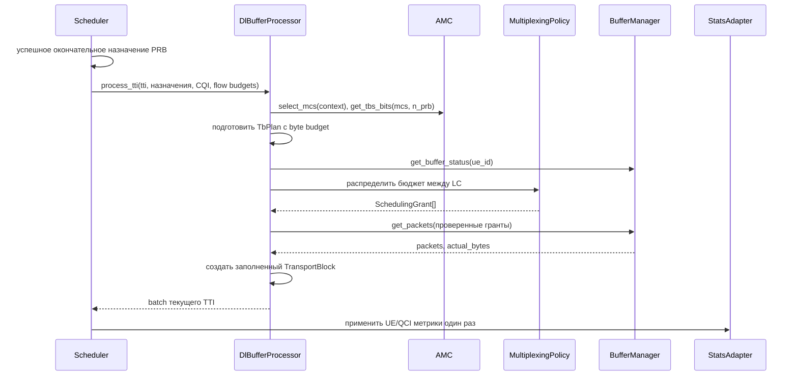

# Спецификация модуля транспортных блоков

> Ответственный: Влад.  
> Состояние: структура TB вынесена в отдельный модуль, TBS рассчитывается при создании; формирование и наполнение TB в рабочем пайплайне не подключены.  
> Написано по коду: `SPEC-FEAT-TB-002@45ecfe9`.  
> Обновлено: `2026-11-23`.  
> Идентификатор документа: `SPEC-FEAT-TB-002`.

## Транспортный блок

**Краткое описание:** `PyScheduler/TRANSPORT_BLOCK.py` предоставляет `TransportBlock` — контейнер одной передачи конкретному UE. Он хранит выбранный индекс MCS, число выделенных PRB, номинальный TBS в битах, список пакетов или фрагментов и поля для будущей интеграции HARQ. Расчёт TBS делегируется AMC.

**Проблема:** в существующем пайплайне Scheduler извлекает пакеты по формульной вместимости PRB и сразу обновляет throughput. Отдельный объект передачи с параметрами и сохранённым содержимым не создаётся. Поэтому готовность класса TB ещё не обеспечивает единый бюджет передачи, хранение payload и возможность повторного использования содержимого при HARQ.

**Цель:** связать решение планировщика с данными, извлечёнными из очередей, через один явно сформированный объект. MCS и TBS окончательного назначения должны определять бюджет извлечения, содержимое TB должно сохраняться, а номинальная ёмкость, payload и padding — учитываться раздельно.

**Реализованные изменения:**

1. `TransportBlock` размещён в отдельном `TRANSPORT_BLOCK.py`; импорт через `SCHEDULER.py` сохранён.
2. `buffer` аннотирован как `list[TRAFFIC_MODEL.Packet]`; для каждого экземпляра по умолчанию создаётся собственный список.
3. Класс объявлен `@dataclass(frozen=True)`.
4. Поле `tbs` не принимается конструктором и автоматически рассчитывается в `__post_init__` через `AMC.get_tbs_bits(mcs, rb)`.
5. Проверки MCS и числа PRB централизованы в AMC; TB не дублирует lookup таблицы.

**Влияние на архитектуру:** AMC выбирает параметры и считает TBS, Scheduler распределяет радиоресурсы, BufferManager владеет очередями и выполняет сегментацию. TB хранит результат передачи между этими компонентами. Подключение TB к пайплайну потребует отдельных изменений у владельцев Scheduler, буферов и статистики; оно не выполняется автоматически после импорта класса.

## 1. Термины и единицы

| Обозначение | Смысл |
|---|---|
| TB | Транспортный блок, относящийся к конкретной передаче UE |
| MCS | Индекс схемы модуляции и кодирования |
| PRB | Частотный ресурсный блок; поле `rb` означает количество PRB |
| RBG | Группа PRB, выдаваемая алгоритмом планирования; её номер не равен числу PRB |
| TBS | Номинальный размер всего TB, биты |
| Payload | Фактически извлечённые данные; размеры `Packet.size` выражены в байтах |
| Padding | Неиспользованная часть вместимости TB при принятой модели заголовков |
| LCID | Идентификатор логического канала; несколько LC одного UE могут иметь одинаковый QCI |
| TTI | Шаг планирования; текущая обработка throughput использует 1 мс |

`allocation` планировщика имеет форму `UE_ID -> list[freq_idx]`. Сетка занимает эти частотные индексы в обоих слотах TTI, поэтому число PRB для TBS определяется длиной корректного списка назначения без дополнительного умножения на два. Последняя RBG может быть короче остальных: нельзя подменять число PRB числом групп или фиксированной шириной каждой группы.

## 2. Структура TransportBlock

Фактическое объявление класса, без комментариев модуля:

```python
from dataclasses import dataclass, field
import AMC
from TRAFFIC_MODEL import Packet

@dataclass(frozen=True)
class TransportBlock:
    ue_id: int
    tbs: int = field(init=False)
    mcs: int
    rb: int
    buffer: list[Packet] = field(default_factory=list)
    ndi: int = 1
    rv: int = 0
    harq_id: int = 0

    def __post_init__(self) -> None:
        object.__setattr__(self, "tbs", AMC.get_tbs_bits(self.mcs, self.rb))
```

| Поле | Тип и значение | Назначение и ограничения |
|---|---|---|
| `ue_id` | `int`, обязательное | Получатель; тип и диапазон сейчас самим TB не проверяются |
| `mcs` | `int`, обязательное | Индекс MCS; проверяется функцией AMC, допустимо 0–28 |
| `rb` | `int`, обязательное | Число PRB; проверяется функцией AMC, в текущем профиле 1–110 |
| `tbs` | `int`, `init=False` | TBS в битах, вычисляется при создании |
| `buffer` | `list[Packet]`, по умолчанию новый `[]` | Содержимое TB; автоматически из очередей не наполняется |
| `ndi` | `int`, по умолчанию 1 | Поле New Data Indicator для будущей интеграции HARQ |
| `rv` | `int`, по умолчанию 0 | Redundancy Version; текущий класс не валидирует диапазон |
| `harq_id` | `int`, по умолчанию 0 | Идентификатор будущего HARQ-процесса; сейчас не выделяется менеджером |

Конструктор принимает `ue_id, mcs, rb` и необязательные `buffer, ndi, rv, harq_id`. Аргумента `tbs` в нём нет. Метода `determination_of_size_TB()` в текущем классе также нет: старые описания с ручным пересчётом не соответствуют реализации.

Если проверка MCS/PRB завершается ошибкой, конструктор не возвращает успешно созданный TB. Обещание «при ошибке сохранить прежний tbs» относится к прежнему изменяемому классу и здесь неприменимо.

### Ограничения неизменяемости

`frozen=True` запрещает обычное присваивание полям, например `tb.mcs=10` или `tb.tbs=100`. Однако список и содержащиеся в нём Packet остаются изменяемыми. Вызов `tb.buffer.append(...)` разрешён; если передать готовый список в конструктор, объект сохраняет этот список без копирования.

`default_factory=list` защищает только от общего списка по умолчанию. Он не создаёт независимый snapshot переданных пакетов и не гарантирует сохранность содержимого при будущих повторах. Автоматической проверки `sum(packet.size)*8 <= tbs` сейчас нет. Например, TB с MCS=0 и 1 PRB имеет TBS 16 бит, но код позволяет поместить в его список Packet размером 3 байта.

## 3. Определение MCS и TBS

TB получает готовый MCS, а не CQI. Для выбора MCS существует AMC: совместимый `get_mcs_from_cqi()` и новый `select_mcs(McsSelectionInput(...))` с подставляемой политикой. Стандартная новая политика `LegacyWbMcsPolicy` использует WB-CQI. Подробный контракт AMC собран в [FEAT-AMC-004](FEAT-AMC-004.md).

Внутри `__post_init__` выполняется:

```text
MCS → GLOBALS.mcs_to_itbs[mcs] → I_TBS
TBS bits = GLOBALS.TBS_TABLE[I_TBS][rb − 1]
```

`AMC.get_tbs_bits()` принимает только тип именно `int` для MCS и PRB, отклоняет `bool` и `float` и возвращает `ValueError` для неверных диапазонов. Ширина таблицы 110 не означает, что любая станция располагает 110 PRB: доступную полосу и фактическое успешное назначение проверяет Scheduler.

При 0 PRB блок не создаётся; вызов lookup с `rb=0` недопустим. CQI=0 также не является разрешением новой передачи, даже если legacy-политика возвращает MCS=0. Проверка возможности передачи остаётся у планировщика.

| MCS | PRB | TBS |
|---|---|---|
| 0 | 1 | 16 бит = 2 байта |
| 0 | 2 | 32 бита = 4 байта |
| 0 | 3 | 56 бит = 7 байт |
| 18 | 10 | 3240 бит = 405 байт |

TBS всего назначения нельзя получать суммированием независимых TBS отдельных RBG или умножением TBS одного PRB на число PRB. При фиксированном MCS прирост ёмкости оценивается разностью TBS нового и прежнего общего назначения. Ёмкость нулевого назначения задаётся снаружи как 0.

В GLOBALS принято проектное значение `TBS_TABLE[6][0]=88` бит. Эта договорённость уже отражена в коде; возврат к значению 328 из устаревших материалов не входит в оформление документации. Наличие таблицы и проверка её размерности не заменяют проверку соответствия выбранному профилю.

## 4. Содержимое блока и взаимодействие с буферами

Для содержимого используется `Packet` из `TRAFFIC_MODEL.py`, а не одноимённый legacy-класс из UE_MODULE. Основные поля пакета: `size` в байтах, `ue_id`, `creation_time`, `qci`, `priority`, `ttl_ms`, `deadline`, `is_fragment`, `bearer_id`.

`buffer_manager.get_packets(grants)` возвращает `(packets, actual_bytes)` и немедленно изменяет очереди. SimpleBuffer создаёт отдельный фрагмент и уменьшает остаток исходного Packet; RLCUM использует `Packet.split_packet()`. Сохранение возвращённого списка в TB не должно вызывать повторное извлечение или ещё одно уменьшение счётчиков очереди.

В Packet нет прямого поля LCID. При нескольких LC одного QCI нельзя восстанавливать канал только по QCI: нужен надёжный mapping bearer→LCID либо структурированный результат extraction с принадлежностью сегментов. Изменение этого контракта относится к владельцу буферов.

### TransportBlock и SchedulingGrant

| Объект | Что описывает | Кто использует |
|---|---|---|
| `allocation` | Назначенные частотные PRB UE | Scheduler и ресурсная сетка |
| `SchedulingGrant` | Бюджет извлечения в байтах для UE/LCID | Мультиплексор и BufferManager |
| `TransportBlock` | Параметры передачи, TBS и сохранённый payload | Будущий сервис формирования TB и потребитель передачи |

Один TB может наполняться по нескольким грантам разных LC. Грант не является TB и не хранит его содержимое. Поля HARQ названы по-разному: `harq_id` в TB и `harq_process_id` в гранте; при подключении менеджера требуется явное соответствие, а не молчаливое переименование legacy-полей.

## 5. Текущий пайплайн обработки буферов

```text
SimulationManager.run_tti()
  → обновление UE и очередей, генерация трафика
  → Scheduler.schedule()
    → CQI / eligibility / priorities / prefilter
    → PDCCH allocation → PDSCH allocation
    → _process_buffers()
      → WB-CQI → amc_view.bits_per_rb()
      → число PRB × формульная вместимость → max_bytes
      → _logical_channel_multiplexing(max_bytes, statuses)
      → BufferManager.get_packets(grants)
      → обновление UE throughput, EWMA и QCI tracker
    → кэши статистики и результат
```

TransportBlock импортирован в SCHEDULER, но в этом рабочем цикле не создаётся. Извлечённые Packet после обновления метрик не сохраняются в TB. Новый `select_mcs()` в алгоритмах не вызывается, табличный TBS не ограничивает фактический payload.

### Мультиплексирование логических каналов

Базовая политика Scheduler в Simple-режиме выдаёт один грант с `lcid=None` на весь byte budget. В Layered-режиме бюджет делится поровну между непустыми LC целочисленным делением. Короткая очередь не передаёт свою свободную долю другим каналам, остаток деления также не перераспределяется. Непустой список только с пустыми LC вызывает деление на ноль.

Только `QosAwareScheduler` переопределяет мультиплексор. Он читает `allocation_flow[(UE,QCI)]` в битах, сортирует LC по приоритету QCI и ограничивает гранты общим byte budget. `BasicQosAwareScheduler` использует базовую политику. При нескольких LC одного QCI старый QoS mux может повторно выдать один flow-бюджет: общий остаток по QCI не уменьшается между LC.

При выносе этапа нельзя заменить все вызовы базовым мультиплексором: это потеряет QoS-переопределение. Временный совместимый способ — передать связанный callback `self._logical_channel_multiplexing`; целевой — отдельная `MultiplexingPolicy` с явным snapshot flow-бюджетов текущего TTI.

### Проблемы текущего учёта

`_process_buffers()` прибавляет `remainder_bits` от формульной ёмкости к `actual_bytes*8`. Эти биты не представляют реально извлечённые данные. При TBS-интеграции app payload должен считаться по фактическому объёму пакетов без такого прибавления.

Ранний выход через `_empty_result()` обходит этап обработки буферов. Новый сервис должен явно очищать TB текущего TTI и завершать нулевые обновления метрик; иначе возможно использование предыдущих `last_ue_transmitted_bits`/throughput.

LayeredBufferManager извлекает данные по грантам последовательно. Ошибка позднего LC может возникнуть после изменения раннего; общий `except` в Scheduler не выполняет откат. Будущий builder не должен скрывать частичную мутацию как нулевую передачу.

## 6. Варианты выноса обработки и место создания TB

Все новые компоненты в этом разделе — предложения, а не существующие API.

| Вариант | Где выполняется обработка | Мультиплексор и статистика | Оценка |
|---|---|---|---|
| А. Частичный вынос | Builder для одного UE строит план TB, извлекает payload и создаёт блок | Цикл и метрики остаются в Scheduler; mux передаётся callback | Небольшой переходный шаг, полного выноса нет |
| Б. Отдельный `DlBufferProcessor` | Один сервис выполняет этап после PDSCH allocation | Mux — передаваемая политика; batch применяется единым stats adapter | Рекомендуемый вариант; внешний `schedule()` сохраняется |
| В. Внешний MAC-пайплайн | `SimulationManager.run_tti()` вызывает processor после планирования | Нужен совместимый фасад для прямых потребителей schedule и новый порядок collect | Возможен после стабилизации Б; шире область изменений |
| Г. Полный перенос в BufferManager | Менеджер очередей получает также AMC/mux/статистику | Ответственности смешиваются | Не рекомендуется; полезно вынести туда только атомарность extraction |

Рекомендуемая цепочка вызовов:



До извлечения предлагается создавать лёгкий `TbPlan`, содержащий UE, TTI, окончательные PRB, MCS, TBS и byte budget. После извлечения и проверки возвращённых данных создаётся финальный TB с содержимым. Альтернатива — пустой TB до mux с последующим заполнением списка; она технически возможна, но требует защиты от публикации недостроенного блока.

`TransportBlock` остаётся моделью данных: в него не передаются Scheduler, BufferManager, сетка или callback на состояние планировщика. Processor также не управляет CCE, active window и RR offsets.

## 7. Правила предлагаемого формирования TB

Начальные условия интеграции: один DL TB на UE за TTI, один codeword, без HARQ и модели PHY-ошибок. Для первого этапа допускается WB-MCS и явный `overhead_bytes=0`. Это упрощение проекта, а не утверждение о полном моделировании служебных заголовков MAC/RLC.

1. Проверить окончательное успешное назначение PRB: диапазон полосы, уникальность индексов и отсутствие пересечений UE. При отсутствии PRB или разрешения передачи вернуть нулевой результат без TB.
2. Выбрать MCS один раз по согласованной политике AMC. Для будущего allocation-aware MCS, уже определённого allocator, передать готовое значение, не выбирать его заново в processor.
3. Рассчитать TBS всего назначения. При использовании текущего конструктора TB lookup повторится для тех же MCS/PRB; он должен дать тот же размер. Не допускается повторный выбор MCS или другая формула ёмкости.
4. Определить `payload_budget_bytes=tbs_bits//8-overhead_bytes`. При переменных заголовках их размер должен входить в packing до разрушительного extraction, а не вычитаться после него.
5. Получить гранты выбранной политики. До мутации проверить UE/LCID, целочисленные неотрицательные размеры, общий byte budget и совместный остаток flow-бюджета. Пустой список не передавать `get_packets()`.
6. Один раз извлечь пакеты и проверить `actual_bytes == sum(p.size for p in packets)` и `0 <= actual_bytes <= payload_budget_bytes`. Проверка после extraction обнаруживает нарушение, но сама не откатывает очередь: для восстановления нужна атомарность у BufferManager.
7. При положительном payload создать заполненный TB и сохранить его в batch текущего TTI. При нулевом payload предлагается не публиковать padding-only TB, ёмкость назначения учитывать как неиспользованную, throughput=0.
8. Учесть `payload_bits=actual_bytes*8` и `padding_bytes=tbs_bits//8-overhead_bytes-actual_bytes` раздельно. Не считать padding, overhead или старый remainder данными приложения.
9. Обновить метрики всех UE, включая неслуженных, ровно один раз за TTI и до следующего PF-планирования: EWMA влияет на будущие приоритеты.

Дополнения к модели: TTI, идентичность TB, индексы PRB, payload/padding/overhead и связь сегментов с LCID. Их имена и размещение следует согласовать, сохраняя доступ к текущим полям TB. Для начала допустим отдельный результат передачи с этими метаданными без ломки существующего конструктора.

### Переход на TBS в алгоритмах

В переходном режиме финальный byte budget ограничивается таблицей, а prefilter и allocation пока остаются формульными эвристиками. Это уже позволяет формировать реальные объекты TB, но может давать лишние/недостающие PRB и требует ясного обозначения модели метрик.

В целевом режиме prefilter, остановка allocator и финальный бюджет используют одну согласованную оценку всего назначения. Для фиксированного WB-MCS — `C(n_new)-C(n_old)`, с `C(0)=0` во внешней обёртке. При будущей SB-aware политике добавление слабой группы может изменить MCS всего TB; правила принятия такого кандидата определяет владелец Scheduler.

Механический перенос этапа проверяется на сохранение старых результатов. Подключение TBS меняет численные результаты payload и потенциально дальнейшее распределение PF, поэтому для него фиксируется отдельный baseline. Нельзя одновременно обещать полный нулевой дрейф и незаметную смену модели вместимости.

## 8. Совместимость с веткой Тимура

Для ранее изученной ветки `dokbrawn/project_py_scheduler:M2(a-b)` зафиксирован snapshot `9743107a2cc0e927123d97fec03fcea7721a46fa`. Это состояние предыдущего разбора, а не утверждение об актуальном HEAD удалённой ветки на любую последующую дату.

| Вопрос | Локальная база `45ecfe9` | Snapshot Тимура `9743107` |
|---|---|---|
| AMC/TB | Отдельные модули, таблица TBS и публичный amc_view setter уже есть | AMC ещё внутри SCHEDULER, выделенных AMC/TB и локальной TBS-таблицы нет |
| Ротация | Старые поля RR/FD_FGS | Один SchedulerState у SchedulerInterface, offsets через него и compatibility properties |
| Буферный этап | Внутри Scheduler, формульный бюджет | То же поведение; базовый и QoS mux эквивалентны |
| Будущий вход processor | Снимок allocation и allocation_flow | В плане Тимура предусмотрен AllocationResult с ue_prbs/flow_budget_bits |
| Выбор mux | Legacy override/callback | В плане предусмотрен компонент MultiplexingPolicy в дескрипторе пары |

M2 не требует иной границы выноса буферов: рекомендуемый processor подключается после allocation и не владеет SchedulerState. Для совместной версии нужно объединить уже реализованные локальные AMC/TB с M2, сохранив обе стороны. Повторно выносить AMC не требуется; заменять целиком SCHEDULER локальным файлом нельзя.

До появления AllocationResult можно использовать адаптер существующего словаря allocation и snapshot allocation_flow текущего TTI. После появления нового результата меняется источник данных, а processor сохраняется. AllocationResult описывает решение о ресурсах; batch описывает сформированные TB и фактическое извлечение. Это разные контракты.

При legacy callback сохраняется QoS override. После перехода на компоненты используется MultiplexingPolicy из дескриптора; BasicQosAware сохраняет базовую политику. SchedulingGrant и общие результаты следует размещать в нейтральном contracts-модуле либо передавать через адаптер, сохраняя старый импорт из SCHEDULER и избегая обратного импорта processor→Scheduler.

## 9. HARQ и срок жизни содержимого

Поля `ndi`, `rv`, `harq_id` — подготовка к интеграции, а не работающий HARQ. В Scheduler `harq_manager=None`; `_get_harq_retransmissions()` является заготовкой и из текущего schedule не вызывается. ACK/NACK, таймеры, лимит попыток и автоматическое управление RV/NDI не реализованы.

Для дальнейшего HARQ требуется:

- определить владельца процессов, число процессов, источник feedback и задержку ACK/NACK;
- сохранять payload до ACK или завершения допустимых попыток, повтор не извлекает новые данные из Buffer;
- защитить содержимое: tuple изменяемых Packet сам по себе недостаточен, нужен неизменяемый snapshot сегментов/метаданных либо гарантированное владение;
- явно связать harq_id TB и harq_process_id гранта, определить NDI/RV и ограничения ресурса повтора без незаметного изменения TBS исходного блока;
- разделить учёт попыток передачи и app goodput: повтор не должен повторно увеличивать объём успешно доставленных данных.

На первом этапе без модели ошибок payload учитывается с допущением успешной передачи. Сам факт extraction или создания TB не доказывает подтверждённую доставку.

TB текущего TTI должен иметь назначенного потребителя. Возврат нового поля из schedule недостаточен, если главный цикл отбрасывает результат run_tti. Для первых метрик достаточно ограниченного snapshot текущего шага; накопление всех Packet за всю симуляцию не требуется. После подключения HARQ срок хранения задаётся жизненным циклом процесса.

## 10. Примеры использования

Примеры выполняются из `PyScheduler` либо при добавлении его в путь импорта.

### Создание пустого блока

```python
from TRANSPORT_BLOCK import TransportBlock

tb = TransportBlock(ue_id=1, mcs=18, rb=10)
assert tb.tbs == 3240
assert tb.buffer == []
# TBS рассчитан в конструкторе; очередь UE не менялась.
```

### Сохранение уже полученного содержимого

```python
from TRAFFIC_MODEL import Packet

packet = Packet(size=100, ue_id=1, creation_time=0)
tb = TransportBlock(ue_id=1, mcs=18, rb=10, buffer=[packet])
payload_bytes = sum(p.size for p in tb.buffer)
padding_bytes = tb.tbs // 8 - payload_bytes  # упрощённо, overhead=0
assert payload_bytes == 100
assert padding_bytes == 305
```

Пример показывает хранение списка, а не автоматическую сегментацию или готовую интеграцию с очередью. Проверка бюджета сейчас выполняется вызывающим кодом; класс сам не отклонит слишком большой payload.

### Совместимый импорт

```python
from SCHEDULER import TransportBlock as LegacyTransportBlock

assert LegacyTransportBlock is TransportBlock
```

Оба существующих пути импорта сохраняются. Ручное изменение MCS/PRB/TBS у frozen-объекта не является поддерживаемой операцией: для нового назначения создаётся новый объект. Отсутствующий в текущей реализации старый метод ручного пересчёта не объявляется действующим legacy API.

## 11. Требования участникам и порядок реализации

| Владелец | Конкретное действие | Критерий приёмки |
|---|---|---|
| AMC и TransportBlock | Согласовать план/фабрику TB, метаданные и защиту payload; использовать единый get_tbs_bits | MCS/TBS совпадают в плане и TB, единицы явные, legacy-импорты сохранены |
| Тимур, Scheduler | Вызвать processor после успешного allocation; передать PRB/CQI/flow snapshots; завершать пустые TTI | Один extraction и одно обновление UE/QCI за TTI, нет stale TB, сохранены QoS и RR state |
| Тимур, allocator/prefilter | Отдельно подключить оценку TBS всего назначения во всех восьми алгоритмах, PF rate и QoS budgets | Единая модель capacity; новый численный baseline без смешивания с механическим переносом |
| Владелец mux/QoS | Сохранить выбор базовой и QosAware-политик; отдельно исправить пустые LC и расход общего QCI-бюджета | Гранты не превышают TB/flow budgets; два LC одного QCI не получают один бюджет повторно |
| Владелец BS_MODULE | Проверять все гранты до мутации, обеспечить атомарность по UE или reserve/commit/cancel; сохранить принадлежность сегментов LC | Ошибка второго гранта не списывает первый частично; фактический объём равен сумме размеров и уменьшению очередей |
| Владелец статистики и UE | Capacity из TBS-планов, payload из extraction; padding/overhead отдельно; один писатель EWMA | Нет фиктивных remainder bits, двойного учёта и метрик предыдущего шага |
| Владелец SimulationManager | Назначить потребителя batch и срок хранения; при внешнем MAC вызвать collect после исполнения | TB не теряется при отбрасывании результата run_tti; PF следующего TTI видит новые данные |
| Владелец GLOBALS | Сохранять единые таблицы и документированную политику исключения | Нет расходящихся копий TBS внутри builder/TB |

В первую очередь фиксируется baseline, затем отдельно выносится обработка без изменения формул и грантов. После этого включаются TbPlan/TB, табличный бюджет и корректный payload accounting. Далее согласованно меняются allocator/prefilter и отдельно исправляются политики LC; HARQ подключается после стабильного new-data пути.

Переключение legacy/TBS использует один исполняемый путь за TTI. Для сравнения нужны независимые симуляции с одинаковыми входами: запуск двух processors на одних очередях удвоит разрушительное извлечение.

Сохраняются существующие `schedule()`, поля `allocation/bitmap/pdcch_stats`, `get_packets(grants)`, импорты и свойства `rr_*_offset` там, где они поддерживаются. Новые сведения вводятся совместимыми адаптерами или дополнениями; удаление legacy-интерфейсов не планируется.

Изменения чужих модулей выполняются их владельцами по этим требованиям. Код AMC и TransportBlock в `-dev` также меняется только после отдельного согласия пользователя.

## 12. Проверки и известные ограничения

Для текущего класса проверяются создание с правильным TBS, ошибки MCS/PRB, отсутствие tbs в аргументах конструктора, запрет присваивания frozen-полям, независимость списков по умолчанию и совместимый импорт. Отдельно фиксируется ограничение: переданный список и Packet остаются изменяемыми, payload не валидируется автоматически, HARQ-поля пока не управляются.

Для внедрения в пайплайн обязательны случаи 0 PRB, CQI=0, пустые LC и пустые гранты, сегментация большого Packet, payload меньше TBS и точное заполнение, короткая последняя RBG, несколько LC одного QCI, SB fallback, ошибка позднего гранта, пустой TTI после непустого, единственный учёт payload и сохранность содержимого между попытками.

### Результаты предыдущего разбора

При сравнении локальной базы `45ecfe9` и snapshot Тимура `9743107` проверялись 8 алгоритмов в Simple/Layered на сценарии 10 MHz, 3 UE с CQI 13/7/15, пакетами 1000/5000/300 байт и одним bearer QCI 9. За 3 TTI в 14 рабочих сочетаниях совпали allocation, PDCCH, гранты, throughput/EWMA, остатки очередей и RR offsets. Две QoS/Simple комбинации завершились одинаковыми ошибками. Это проверка данного legacy-сценария, не полная регрессия и не тест готового TB-пайплайна.

В том же разборе layered buffer tests дали 14 passed / 1 failed: ожидание накопительного packets_expired в `test_packet_discard` расходится со сбросом счётчика на очередном шаге. Сбор scheduler tests завершился четырьмя ошибками отсутствующего `log_utils`. Эти результаты не означают успешную приёмку всего проекта.

При оформлении этой версии документа повторно проверяются примеры и фактический контракт TransportBlock. Полная симуляция и новый HARQ-пайплайн в рамках документации не реализуются и не объявляются проверенными.
