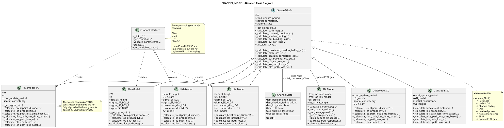
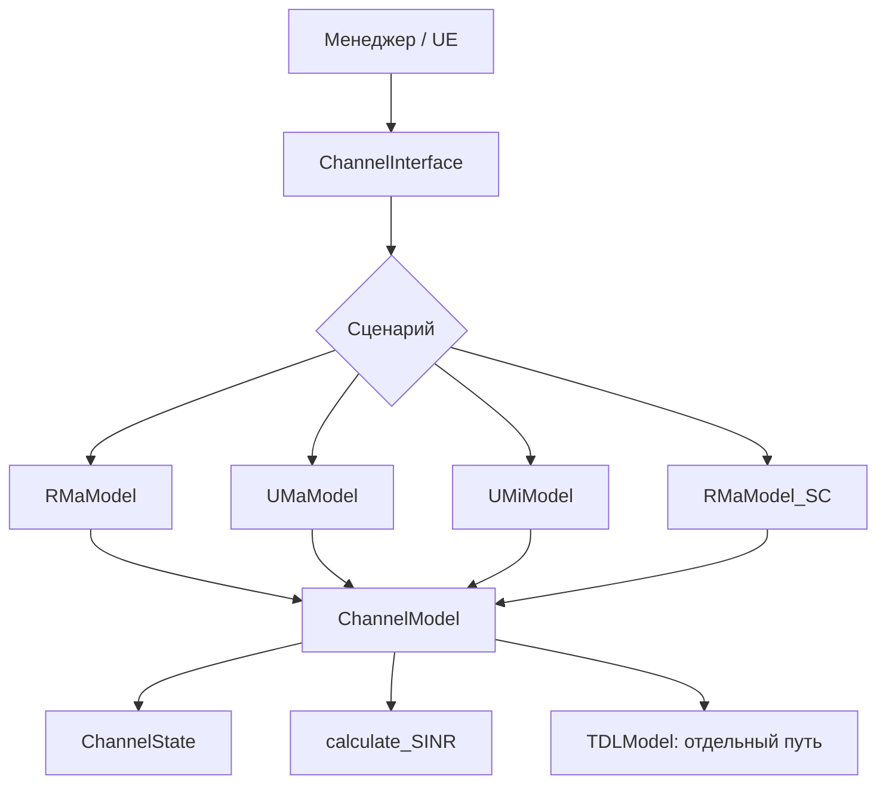
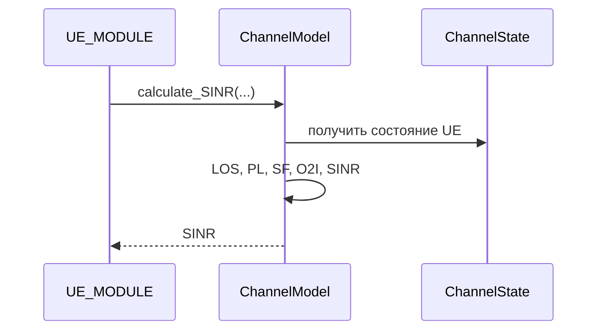
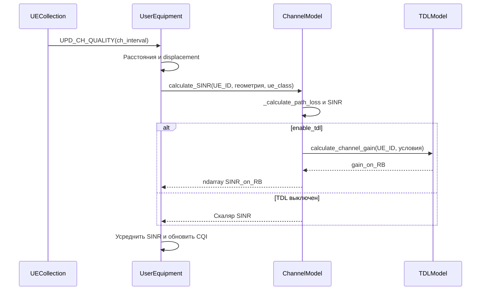
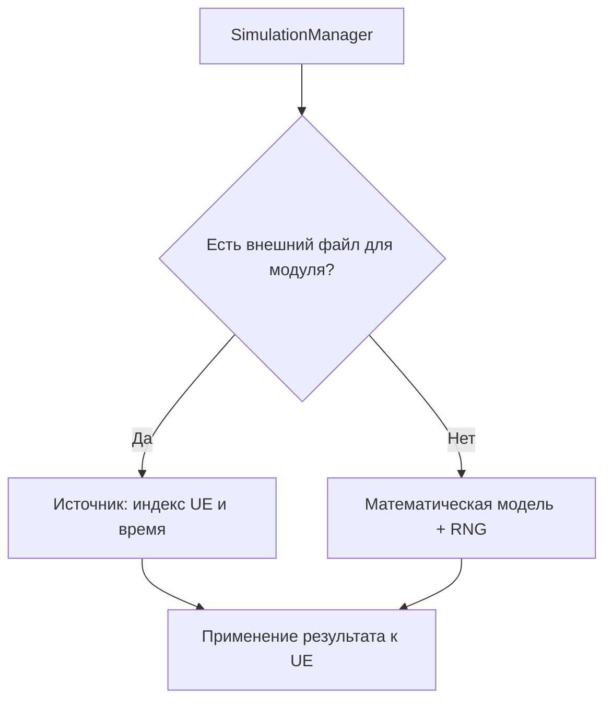

# Диаграммы модуля CHANNEL_MODEL

> Ответственный: Кутенков Андрей | Проверено по коду: `ae9db40ecfd27787b4cdeba79bcb6eafabd7d44b` | Обновлено: 2026-10-17

Исходные диаграммы и все их узлы, связи и подписи сохранены. Исходные схемы сохранены как авторские материалы; ниже добавлены результаты сверки с кодом. SVG не перерисовывались, поэтому сверка маршрутов не означает автоматической проверки каждой связи внутри SVG.

## 1. Текущая структура (AS-IS)

### 1.1. Исходная UML-диаграмма

### 1.2. Исходное дерево операций

Сверка дерева: RMa/UMa/UMi и TDL подтверждены. RMa-SC присутствует в реестре, но его создание падает с TypeError; UMa-SC и UMi-SC не зарегистрированы. ChannelState относится к SC; стандартный calculate_SINR использует словари ChannelModel и _calculate_path_loss. Исходная логическая схема сохранена, ограничения отражены в audit.

### 1.3. Все исходные графические материалы

- [channelmodelClasses.svg](assets/channelmodelClasses.svg) — сохранён без изменения содержимого.

## 2. Типовой сценарий (AS-IS)

Исходная концептуальная последовательность сохранена без изменения. Надписи в ней отражают прежнюю редакцию; точный маршрут проверен по коду проекта и показан дополнительно ниже.

### 2.1. Уточнённая последовательность по коду проекта

## 3. Целевая структура (TO-BE) — только если согласована

Не согласовано, см. [features.md](features.md). Ниже сохранена ваша исходная обзорная схема предложения. Она иллюстрирует развилку источников, а не вводит отдельную спецификацию. Единственный подробный контракт — [INT-MF-001](../../integration_report.md). В его file-режиме математическая модель и RNG не создаются и не вызываются.

## 4. Ссылки на исходники

- `PyScheduler/CHANNEL_MODEL.py::ChannelInterface.create` — наличие и сигнатура подтверждены по указанной версии кода.
- `PyScheduler/CHANNEL_MODEL.py::ChannelModel.calculate_SINR` — наличие и сигнатура подтверждены по указанной версии кода.
- `PyScheduler/CHANNEL_MODEL.py::ChannelState` — наличие и сигнатура подтверждены по указанной версии кода.
- `PyScheduler/CHANNEL_MODEL.py::TDLModel.calculate_channel_gain` — наличие и сигнатура подтверждены по указанной версии кода.

## 5. Сохранённые ветви для возможного распараллеливания
- **Между UE:** потенциально независимые операции при раздельном состоянии и RNG.
- **Внутри UE:** порядок обновления состояния обязателен; зависимые шаги нельзя распараллеливать без проверки.
- **Между модулями:** Mobility → Channel по координатам; Traffic потенциально параллелен расчёту Mobility при фиксированном снимке входов.
- Это кандидаты, а не доказательство потокобезопасности или ускорения.

### Связанные вызывающие компоненты

- `PyScheduler/SIMULATION_MANAGER.py::SimulationManager.run_tti` — физика, Traffic, буферы и scheduler.
- `PyScheduler/UE_MODULE.py::UECollection.UPDATE_ALL_USERS` — интервалы Mobility/Channel.
- `PyScheduler/UE_MODULE.py::UserEquipment.UPD_POSITION` и `UPD_CH_QUALITY` — применение результата.
