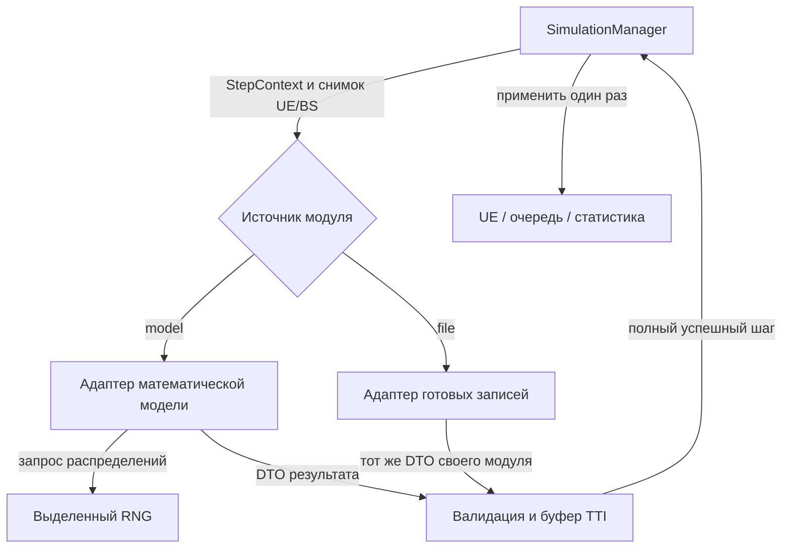

# Интеграция Mobility / Channel / Traffic: model/file и RNG

> Ответственный: Кутенков Андрей  
> Крупная фича: FEAT-INT-001 | Авторская зона: Mobility / Traffic / Channel  
> Дата: 2026-10-17 | Статус: выбранный единый черновик для обсуждения; командного согласования нет  
> Текущий код: проверен по коду ветки dev `ae9db40ecfd27787b4cdeba79bcb6eafabd7d44b`. Имена новых DTO, адаптеров и source.read_step ниже — проектные, в коде пока отсутствуют.

## 1. Назначение и границы
Обеспечить для каждого из трёх модулей независимый выбор математической модели либо файла готовых результатов. Сохранить связь результатов с UE, радиолинией и временем, исключить случайную генерацию при подключённом файле.

Входит: выбор источника, единицы, форматы результатов и файлов, порядок шага, ошибки, воспроизводимость, жизненный цикл и приёмка. Не входит: файл случайных величин, онлайн-переключение источников, интерполяция, реализация чужих модулей и изменение математических формул.

### 1.1. Подтверждённое текущее состояние (AS-IS)
- `PyScheduler/SIMULATION_MANAGER.py::SimulationManager.run_tti` вызывает UECollection.UPDATE_ALL_USERS при кратности общего update_interval; затем traffic_gen.generate_packets и buffer_manager.add_packet; после — scheduler.schedule.
- `PyScheduler/UE_MODULE.py::UECollection.UPDATE_ALL_USERS` проверяет отдельные интервалы движения/канала. Default: общий 1 мс, Mobility 500 мс, Channel 1 мс. При current_time=0 условия кратности тоже истинны.
- `UserEquipment.UPD_POSITION` вызывает конкретную mobility_model.update; `UPD_CH_QUALITY` вызывает serving_bs.channel_model.calculate_SINR. В UE имеются дополнительные случайные ветви высоты: запрет RNG в Channel file должен охватывать и эти ветви, а не только CHANNEL_MODEL.
- Traffic получает текущее время как **конец** окна `(current_time-update_interval)..current_time`; времена пакетов дробные. Строгое исключение правой границы в текущем коде отсутствует (`>` вместо `>=`).
- Channel выдаёт скаляр без TDL и ndarray с TDL; время TDL — GLOBALS.CURRENT_TIME, обновляемое циклом SimulationManager. Помеха пока постоянна -95 dBm.
- В проекте отдельного RNG-модуля и готовой маршрутизации model/file нет. Модели используют np.random. Экспорт CSV/JSON в менеджере относится к статистике, не к импорту готовых результатов моделей.

### 1.2. Что реально проверено
Все 162 описанных метода найдены в исходниках, сигнатуры извлечены в README. Выполнены 27 unit и 36 integration тестов Mobility — все 63 прошли. Симуляция запускалась автором. Дополнительно выполнены минимальные сценарии трёх моделей и целевые проверки замечаний audit. Результаты этих проверок приведены отдельно от сведений об авторском запуске. Исходный код при подготовке документации не изменялся.

### 1.3. Переход к TO-BE
Ниже фиксируется будущий контракт. Адаптер Traffic должен передавать существующим generate_packets/generate_traffic **current_time=t_end_ms**, update_interval=dt_ms. Полуинтервал будущего контракта потребует явно согласованной обработки точного попадания на правую границу. Нельзя просто передать t_start_ms существующей модели — получится предыдущее окно.

Для Mobility/Channel потребуется согласовать старт при t=0 и отдельные частоты обновления: текущий вызов на нулевом тике уже перемещает UE на mob_interval. Целевой снимок на t_end_ms не объявляется эквивалентным этому поведению. До смены порядка сравнить исходный сценарий и зафиксировать решение владельца SM.

## 2. Архитектура и ответственность



- SimulationManager владеет часами, реестром источников, снимком входов и применением результатов.
- Общий загрузчик читает, валидирует и индексирует файлы перед стартом; файловые адаптеры знают семантику своего модуля. Файлы не читаются заново на каждом TTI.
- Адаптеры математических моделей приводят существующие сигнатуры к DTO; существующий код не объявляется уже совместимым.
- RNG предоставляет величины, но не координаты, пакеты или SINR.
- В file математический экземпляр и его RNG-поток не создаются, включая случайную инициализацию в конструкторе. Пакет можно создать как DTO/Packet без вызова генератора Traffic.

## 3. Конфигурация и время
Черновик конфигурации; JSON для наглядности, это не существующий файл запуска:

```json
{
  "integration_schema": "INT-MF-001/1.0",
  "seed": 42,
  "sources": {
    "mobility": {"mode": "file", "path": "mobility.jsonl"},
    "traffic": {"mode": "model", "model": "Poisson"},
    "channel": {"mode": "file", "path": "channel.jsonl", "profile": "sinr-v1"}
  }
}
```

`mode` обязателен: только `model` или `file`. В file требуется непустой path; поле model запрещено. В model path запрещён, модель и её параметры проходят собственную валидацию. Противоречия — ошибка до запуска. Выбор независим для модулей, одинаков для всех UE внутри модуля в версии 1.0. Источник фиксируется до завершения запуска.

`StepContext = {step_id:int>=0, t_start_ms:int>=0, dt_ms:int>0, t_end_ms:int}`; `t_end_ms=t_start_ms+dt_ms`. Границы шагов и снимки — целые миллисекунды; creation_time_ms и deadline_ms пакетов допускают дробные миллисекунды, как в существующих моделях. Округление времён не выполняется. Шаги следуют без перекрытий и разрывов. Интервал пакетов — `[t_start_ms,t_end_ms)`. Mobility и Channel описывают состояние **на t_end_ms**; на старте снимок UE задаёт состояние t=0. Пересчёт в секунды выполняет адаптер/модель явно: `dt_s=dt_ms/1000`. Интенсивность Traffic — пакеты/с; например `N ~ Poisson(lambda*dt_s)`.

`ue_id` и `bs_id` — неотрицательные целые, стабильные до конца запуска, повторное использование удалённого ID запрещено. Идентификаторы сверяются с конфигурацией. Конечность чисел обязательна; NaN/Infinity не допускаются.

## 4. Интерфейсы и результаты
Единый протокол источника (проектный):

```python
source.initialize(config, ue_registry, bs_registry)
source.read_step(context, snapshot)  # -> list[ModuleResult]
source.remove_ue(ue_id)
source.close()
```

`read_step` не изменяет UE, очередь и глобальную статистику. Для stateful model внутреннее состояние может продвигаться; повтор одного step_id отклоняется. После ошибки весь запуск останавливается, автоматического повтора/отката модели в v1.0 нет. Commit означает атомарное применение к внешнему состоянию: до валидации всех результатов шаг снаружи не виден.

| DTO | Поля | Кратность |
|---|---|---|
| MobilityResult | ue_id, time_ms, x_m, y_m, velocity_mps, direction_rad | Одна запись на активный UE на t_end_ms |
| TrafficResult | ue_id, step_id, packets:list[PacketRecord] | Один список на UE; может быть пустым |
| ChannelResult | ue_id, bs_id, time_ms, profile="sinr-v1", sinr_db:list[float] | Одна запись на каждую настроенную активную пару UE/BS на t_end_ms |

Mobility: координаты внутри конфигурации карты, скорость >=0, угол в `[0,2π)`; нормализация направления — в адаптере, не молча в загрузчике. Детерминированные проверки времени и границ выполняются без RNG.

PacketRecord: `packet_id:str` (уникальный во всём запуске), `ue_id:int`, `bearer_id:int>=0`, `creation_time_ms:float>=0`, `size_bytes:int>0`, `qci:int`, `priority:int`, `deadline_ms:float>=creation_time_ms`. QCI/bearer должны существовать в профиле; priority и deadline должны сохраняться при преобразовании в Packet. Несоответствие QoS — ошибка до commit, без скрытой подстановки. Поля текущего Packet проверены: size, ue_id, creation_time, qci, priority, ttl_ms, deadline, is_fragment, bearer_id. packet_id отсутствует — его добавление остаётся проектным. Конструктор и from_dict сейчас не сохраняют явный deadline; подтверждённая несовместимость отражена в audit Traffic.

Channel sinr-v1: `sinr_db` всегда массив. Для wideband длина 1; для per-RB длина `n_rb`, порядок RB задаётся BS-конфигурацией. У BS явно задаётся один вид выхода на запуск. Отрицательные SINR допустимы. LOS, path loss, shadow fading, O2I и комплексный TDL не входят в профиль. Если потребителю нужны эти поля, запуск sinr-v1 отклоняется как несовместимый: вычислять их «вдогонку» запрещено. Расширение требует новой версии профиля, а не второго параллельного контракта.

## 5. Единственный файловый формат
UTF-8 JSON Lines без BOM: один JSON-объект на строку, без комментариев и пустых строк. Первая строка — метаданные, остальные — готовые записи. Неизвестные поля отклоняются. Сортировка по времени и ID обязательна; дубль ключа — ошибка.

Метаданные: `schema="INT-MF-001/1.0"`, `module`, `start_ms`, `end_ms`. Диапазон `[start_ms,end_ms)` задаёт покрытие Traffic, для Mobility/Channel допустимы конечные отметки до end_ms включительно. План шагов и реестры конфигурации должны целиком покрываться файлом.

### Mobility

```json
{"schema":"INT-MF-001/1.0","module":"mobility","start_ms":0,"end_ms":1000}
{"time_ms":1000,"ue_id":1,"x_m":11.0,"y_m":10.0,"velocity_mps":1.0,"direction_rad":0.0}
{"time_ms":1000,"ue_id":2,"x_m":21.0,"y_m":20.0,"velocity_mps":1.0,"direction_rad":0.0}
```

Уникальный ключ `(time_ms,ue_id)`; для каждого активного UE должна быть запись ровно на t_end_ms. Промежуточные/несовпадающие отметки отклоняются. Интерполяции и удержания предыдущего значения нет.

### Traffic

```json
{"schema":"INT-MF-001/1.0","module":"traffic","start_ms":0,"end_ms":1000}
{"packet_id":"p1","ue_id":1,"bearer_id":0,"creation_time_ms":100,"size_bytes":100,"qci":9,"priority":9,"deadline_ms":400}
{"packet_id":"p2","ue_id":1,"bearer_id":0,"creation_time_ms":100,"size_bytes":200,"qci":9,"priority":9,"deadline_ms":400}
```

Здесь `(ue_id,time_ms)` не является уникальным ключом: допустимы несколько пакетов в одну миллисекунду. Уникален packet_id; сортировка `(creation_time_ms,ue_id,packet_id)`. Пакет на правой границе принадлежит следующему шагу. Отсутствие пакетов в полностью покрытом интервале означает `[]`; выход за покрытие — ошибка. Пакеты UE=2 отсутствуют законно. QoS примера требует соответствующего bearer/QCI в конфигурации; это иллюстрация формата, не запуск текущего кода.

### Channel

```json
{"schema":"INT-MF-001/1.0","module":"channel","profile":"sinr-v1","start_ms":0,"end_ms":1000}
{"time_ms":1000,"ue_id":1,"bs_id":1,"sinr_db":[12.5]}
{"time_ms":1000,"ue_id":2,"bs_id":1,"sinr_db":[-2.0]}
```

Уникальный ключ `(time_ms,ue_id,bs_id)`. profile берётся из метаданных. В этом примере BS настроена на wideband; для per-RB требуется полный массив n_rb, без расширения скаляра на RB.

## 6. Порядок одного шага
1. Зафиксировать StepContext и исходный снимок всех UE/BS; проверить шаг и покрытие источников.
2. Получить MobilityResult для всех UE и проверить его. Подготовить новый снимок координат, ещё не применяя его к UE.
3. Рассчитать/прочитать ChannelResult по новой геометрии. Общие помехи при наличии берутся из одного согласованного снимка; в текущем коде интерференция задана константой -95 dBm; общий снимок помех требует отдельной доработки.
4. Получить TrafficResult за `[t_start_ms,t_end_ms)` для всех UE. В v1.0 порядок последовательный; параллельное исполнение не обещается.
5. Проверить полноту, ключи, типы и QoS всех результатов. При любой ошибке остановить запуск без применения частичного шага.
6. Применить координаты, SINR и пакеты один раз; продвинуть часы и статистику. Одна сторона владеет учётом пакетов; для PacketManager адаптер должен исключить повторный учёт.

Данные обоих источников проходят один валидатор и один путь применения. Выбор источника другого модуля не изменяет режим текущего.

## 7. Ошибки и жизненный цикл
| Ситуация | Обязательное поведение |
|---|---|
| Пропуск Mobility/Channel | Ошибка MissingResult с module, ID и time_ms; RNG не вызывается |
| Пустой Traffic в покрытии | Пустой список, без генерации |
| EOF / недостаточное покрытие | Ошибка до старта либо до commit первого непокрытого шага |
| Дубль / неизвестный ID / плохая размерность | Ошибка валидации с номером строки, ключом и ожидаемым форматом |
| Повтор step_id | DuplicateStep; никаких повторных пакетов и статистики |
| Удаление UE | Очистить модельное состояние и закрыть поток RNG; записи за пределами активного жизненного интервала отвергать при валидации |
| Смена mode во время запуска | Ошибка конфигурации; новый режим только в новом запуске |

Реестр активных интервалов UE/связей должен задаваться до предвалидации; динамическое добавление с неизвестным заранее ID в v1.0 не поддерживается. Новый запуск заново создаёт состояния, индексы файлов и RNG.

## 8. RNG и зависимости
Требуемые возможности: uniform, normal, poisson, exponential, integers. Текущие вызовы — np.random.uniform, normal, exponential, randint, random/rand и choice. Отдельного RNG API нет; перечисленные возможности — требования к новому компоненту, не существующие методы. В model выделяется поток `(module,ue_id)`, для Channel `(module,ue_id,bs_id)`, для независимых bearer — дополнительный bearer_id. Seed стабильно выводится из seed запуска и ключа; встроенный hash Python не использовать. Алгоритм и версия RNG фиксируются в метаданных запуска. Потоки создаются до случайной инициализации модели.

Требования к RNG и SimulationManager подготовлены в [реестре согласования](#11-межмодульные-зависимости-и-согласование). Обращения к глобальным np.random и GLOBALS.CURRENT_TIME подтверждены. При интеграции потребуется заменить/адаптировать эти зависимости; текущий код уже не отвечает будущему требованию изолированных потоков.

## 9. Этапы реализации
1. Первичная сверка моделей/SM/UE выполнена по коду ветки dev; отдельного RNG в нём нет. Закрыть оставшиеся вопросы audit и обсудить отличия AS-IS/TO-BE из раздела 1.3.
2. Обсудить INT-MF-001 и закрепить владельцев интерфейсов; зафиксировать решение и версию.
3. Реализовать DTO/валидаторы и файловые адаптеры с тестовыми JSONL.
4. Реализовать адаптеры математических моделей и передачу RNG; сравнить с исходным сценарием.
5. Владелец SimulationManager подключает маршрутизацию и общий commit, UE — применение результатов.
6. Пройти матрицу ниже и демонстрацию. Календарная декомпозиция — раздел 5 features.md каждого модуля.

## 10. Критерии проверки
| ID | Сценарий | Ожидаемый результат |
|---|---|---|
| INT-T01 | Все 8 комбинаций источников трёх модулей, два UE, два шага | Правильный режим каждого; для file 0 конструкторов математических моделей, 0 расчётов и 0 RNG-вызовов |
| INT-T02 | Одинаковый seed и входы, перестановка UE/BS | Индивидуальные модельные результаты совпадают; версия RNG зафиксирована |
| INT-T03 | Файл Mobility: UE1=(11,10), UE2=(21,20) на 1000 мс | Координаты совпадают; Channel получает именно новый снимок |
| INT-T04 | Traffic p1=100 и p2=200 байт в 100 мс; UE2 без записей | Два пакета, 300 байт, один учёт; для UE2 [] |
| INT-T05 | Пакеты ровно на границе двух TTI | Каждый принадлежит ровно одному полуинтервалу |
| INT-T06 | Нет строки Mobility/Channel | MissingResult, ни fallback к model, ни частичного commit |
| INT-T07 | Один UE у двух BS, затем удаление | Состояния независимы; удалённый ID не появляется вновь |
| INT-T08 | NaN, неверный QCI, дубль packet_id, короткий массив RB | Явная ошибка с ключом/строкой; пакет не применяется |
| INT-T09 | Повтор шага, окончание файла, попытка смены mode | Ошибки раздела 7; нет повторного учёта или RNG |
| INT-T10 | Потребителю нужны PL/LOS, файл sinr-v1 | Несовместимость до запуска; запрещён скрытый расчёт недостающих полей |
| INT-T11 | Пакет с явным deadline=999 | DTO → Packet → сериализация сохраняют 999 либо запуск блокируется до исправления несовместимости |
| INT-T12 | Ошибка Channel после успешного Mobility | Внешние UE и очереди не изменены, запуск остановлен |

Эти тесты целевой интеграции **спроектированы, но не выполнялись**, потому что model/file и новый RNG API ещё не реализованы. Проверки существующих моделей приведены в README и audit; это другой набор проверок. Готовность реализации означает прохождение тестов с логами, SHA, версией конфигурации и подтверждёнными владельцами. Текущая готовность документа — содержательный черновик для согласования.

## 11. Межмодульные зависимости и согласование

| ID | Ответственный за ответ | Конкретный вопрос / требуемый результат | Наша сторона | Статус / блокировка |
|---|---|---|---|---|
| DEP-SM-001 | Владелец SimulationManager | Подтвердить StepContext, порядок TTI, выбор источников на модуль, commit и обработку ошибки | Предоставляем DTO и адаптеры моделей | Не согласовано; блокирует подключение |
| DEP-UE-001 | Владелец UE_MODULE | Подтвердить стабильные ID, активные интервалы, снимок состояния и единичное применение координат/SINR/пакетов | Предоставляем примеры результатов и валидацию | Не согласовано; блокирует применение |
| DEP-RNG-001 | Владелец RNG | Дать фактический API и алгоритм seed; подтвердить ключи потоков, reset и отсутствие RNG в file | Перечисляем распределения и места внедрения | Не согласовано; блокирует model-воспроизводимость |
| DEP-MOD-001 | Владельцы Mobility / Channel / Traffic | Подтвердить время, единицы и поля результатов; Channel sinr-v1 достаточен потребителям? | Сводим решения в INT-MF-001 | Не согласовано; блокирует фиксацию DTO |
| DEP-TRF-001 | Владелец очередей / потребитель Traffic | Кто единожды обновляет статистику и сохраняет deadline/QCI/bearer? | Проверяем адаптер PacketManager и конвертацию Packet | Не согласовано; блокирует file Traffic |
| DEP-CHN-001 | Потребитель Channel / владелец BS | Wideband или per-RB, n_rb, идентификация BS и источник помех | Возвращаем явный массив SINR и bs_id | Не согласовано; блокирует ChannelResult |

### Как зафиксировать ответ
На встрече разобрать каждую строку: владелец, принято/отклонено, точная формулировка API, ссылка на issue/протокол и дата. При изменении контракта обновить INT-MF-001 и связанные FEAT одновременно. Отсутствие ответа не означает согласование. Именованных входящих запросов нет; в features.md каждого модуля выделен отдельный раздел для них.


## 12. Математические основания

Mobility вычисляет перемещение из скорости и направления:

$$\Delta t_s=dt_{ms}/1000,\quad x_{new}=x+v\cos(\theta)\Delta t_s,\quad y_{new}=y+v\sin(\theta)\Delta t_s.$$

Traffic использует интенсивность в пакетах/с: $N(\Delta t_s)\sim Poisson(\lambda\Delta t_s)$. RNG выдаёт случайные величины, Packet создаёт Traffic или файловый адаптер.

Channel может использовать случайный выбор LOS, shadow fading и фаз TDL. Состояние должно быть изолировано по радиолинии UE/BS. Иллюстрация коррелированного SF: $SF_{new}=\rho SF_{old}+\sqrt{1-\rho^2}X$, где $X\sim\mathcal N(0,\sigma^2)$. Это пояснение архитектуры, не проверка конкретных формул текущего кода.

