# Диаграммы модуля SCHEDULER.py

> Ответственный: Тимур (Scheduler) | Проверено по коду: `6c0aae2` (ветка `dev`) | Обновлено: `2026-11-02`  
> Все схемы соответствуют коммиту `6c0aae2`; поведение подтверждено чтением кода и фактическими прогонами (сценарий TTI 5 из [README §4.1](README.md), pytest). Элементы, фактически добавленные шагом M1 [FEAT-SCH-008](features.md#feat-sch-008) в ветке `feat/SCH-008-M1-protocols` (коммит `f14885c`, строки :3246–3584), отмечены в §3 отдельной пометкой «реализовано в M1» — остальные элементы §3 остаются целевым черновиком. Baseline-снимки, которыми подтверждаются прогоны: состав и команды — [README §4.3](README.md), схема снимка и правила сравнения — [SPEC-FEAT-SCH-008 §8.2](specs/SPEC-FEAT-SCH-008.md). Наблюдения, упомянутые на схемах (BUG/OPT/DOC-SCH-xxx), — в [audit.md](audit.md); планируемые изменения (FEAT/OPT-SCH-xxx) — в [features.md](features.md). В метках переходов диаграмм состояний строки кода указаны как «стр. NNN»: второе двоеточие в метке перехода синтаксис Mermaid не допускает.

## 1. Текущая структура (AS-IS)

Кратко: показаны границы модуля, его внутренний состав и структура классов; каждое соединение подтверждено кодом (ссылки в §4) и прогоном сценария TTI 5.

### 1.1. Контекст модуля: границы и побочные эффекты

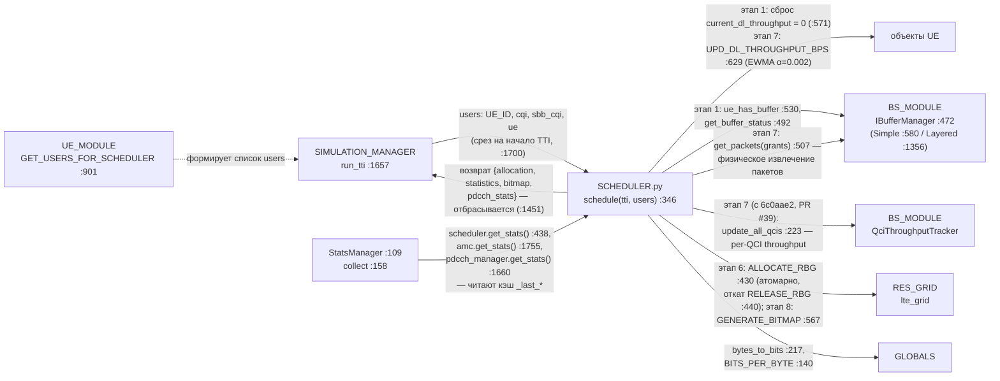

### 1.2. Внутренний состав модуля

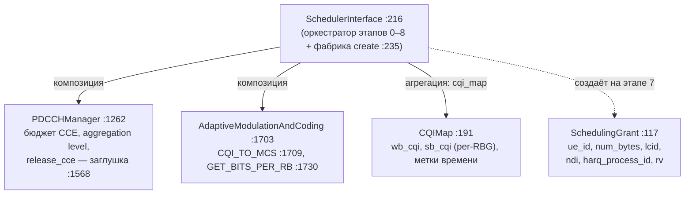

### 1.3. UML классов

```mermaid
classDiagram
    class SchedulerInterface {
        +lte_grid
        +amc
        +pdcch_manager
        +cqi_map
        +create(algorithm, lte_grid, bs)
        +schedule(tti, users) Dict
        +get_stats() Dict
        #_refresh_cqi()
        #_filter_eligible_ues()
        #_update_active_window()
        #filter_by_window()
        #_form_priority_list()
        #_apply_pdsch_estimation()
        #_allocate_pdcch()
        #_logical_channel_multiplexing()
        #_process_buffers()
        #_calculate_priorities()*
        #_allocate_pdsch()*
    }
    class BestCQIScheduler {
        #_calculate_priorities() priority = WB CQI
        #_allocate_pdsch() жадный TD
    }
    class RoundRobinScheduler {
        +rr_rbg_offset
        +rr_ue_offset
        #_calculate_priorities() ротация очереди
        #_apply_pdsch_estimation() pass-through
        #_allocate_pdsch() 1 RBG по кругу
    }
    class ProportionalFairScheduler {
        #_calculate_priorities() r/R
        #_allocate_pdsch() жадный TD
    }
    class FDxBestCQIScheduler {
        #_allocate_pdsch() per-RBG max SB CQI
    }
    class FDxFairGreedyScheduler {
        +rr_rbg_offset
        +rr_ue_offset
        #_allocate_pdsch() per-RBG + served_in_round
    }
    class FDxProportionalFairScheduler {
        #_allocate_pdsch() per-RBG PF по SB CQI
    }
    class BasicQosAwareScheduler {
        +metric_mode (Coita/PF)
        #_calculate_priorities() HOL-группировка + GBR-приоритет
        #_apply_pdsch_estimation() pass-through
        #_allocate_pdsch() per-RBG произведение hol×gbr×cqa
    }
    class QosAwareScheduler {
        +allocation_flow
        #_calculate_priorities() per-flow GBR/urgency
        #_apply_pdsch_estimation() pass-through
        #_allocate_pdsch() per-RBG выбор потока (sigmoid hol/PDB × pf)
        #_logical_channel_multiplexing() override QoS-мультиплексирования
    }
    class PDCCHManager {
        +total_cce
        +max_dl_cce
        +num_assigned_cce
        +get_aggregation_level(cqi)
        +allocate_cce(ue_id, n)
        +reset_tti()
        +release_cce(ue_id) заглушка
        +get_stats()
    }
    class AdaptiveModulationAndCoding {
        +CQI_TO_MCS
        +GET_BITS_PER_RB(cqi)
        +get_stats()
    }
    class CQIMap {
        +wb_cqi
        +sb_cqi
        +last_wb_update
        +last_sb_update
    }
    class SchedulingGrant {
        +ue_id
        +num_bytes
        +lcid
        +ndi
        +rv
        +to_dict()
    }
    SchedulerInterface <|-- BestCQIScheduler
    SchedulerInterface <|-- RoundRobinScheduler
    SchedulerInterface <|-- ProportionalFairScheduler
    SchedulerInterface <|-- FDxBestCQIScheduler
    SchedulerInterface <|-- FDxFairGreedyScheduler
    SchedulerInterface <|-- FDxProportionalFairScheduler
    SchedulerInterface <|-- BasicQosAwareScheduler
    SchedulerInterface <|-- QosAwareScheduler
    SchedulerInterface *-- PDCCHManager
    SchedulerInterface *-- AdaptiveModulationAndCoding
    SchedulerInterface o-- CQIMap : cqi_map
    SchedulerInterface ..> SchedulingGrant : создаёт на этапе 7
```

## 2. Типовой сценарий (AS-IS)

Сценарий: один TTI — вызов `schedule(tti, users)` из `SIMULATION_MANAGER.run_tti()`, включая все выходы за границы модуля. Порядок этапов подтверждён кодом :346–436 и прогоном ([README §4.1](README.md)); полный набор контрольных точек — 27 baseline-снимков ([README §4.3](README.md)).

### 2.1. Последовательность вызовов

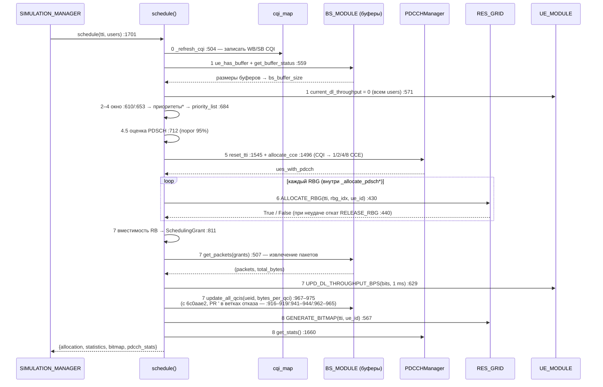

Звёздочкой помечены виртуальные методы — точки расхождения восьми алгоритмов (`_calculate_priorities` :1172, `_allocate_pdsch` :1197); третья точка расхождения — переопределения `_apply_pdsch_estimation` (:712).

### 2.2. Досрочные выходы (dataflow с ветвлениями)

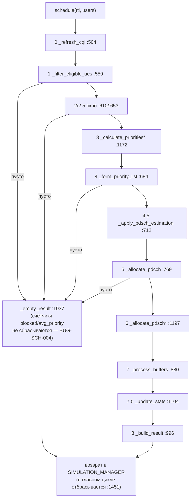

### 2.3. Контур обратной связи между TTI

Проверен замером на `ae9db40`: заранее выставленный `average_throughput` = 1 000 000 у незапланированного UE затухает до 996 004 за один TTI — двойной нулевой шаг EWMA ([BUG-SCH-001](audit.md#bug-sch-001)). На `6c0aae2` (PR #39) ветка получила `continue` (:919) — шаг один: 998 000; контур обратной связи ниже сохраняет смысл.

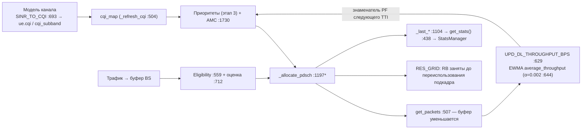

### 2.4. Переходы состояний: жизненный цикл записи CQIMap (на UE)

Заявленный в docstring `CQIMap` (:197–201) жизненный цикл против фактического поведения кода:

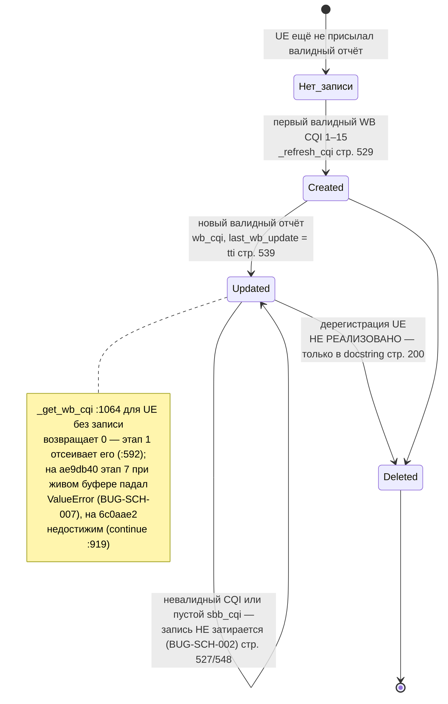

### 2.5. Переходы состояний: бюджет CCE в пределах одного TTI (PDCCHManager)

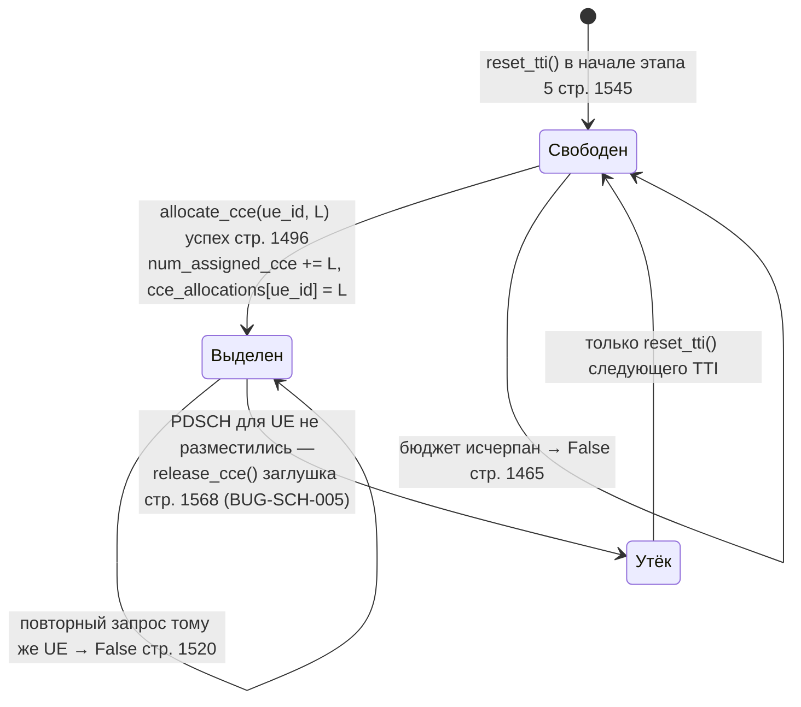

### 2.6. Переходы состояний: UE в скользящем окне (`_ue_queue`)

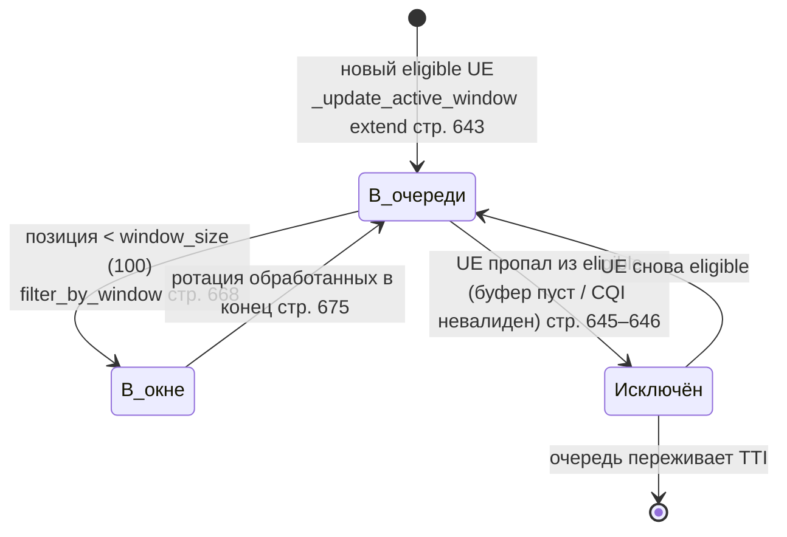

## 3. Целевая структура (TO-BE) — только если согласована

Не согласована: ниже — черновик к спецификации FEAT-SCH-008 v5 (структура TO-BE с v4 не менялась; в v5 добавлены граница с AMC-направлением, порядок слияния и целевой путь пакета — [SPEC §11.3](specs/SPEC-FEAT-SCH-008.md)) (статус и согласование — [features.md](features.md) §1, полный текст — [specs/SPEC-FEAT-SCH-008.md](specs/SPEC-FEAT-SCH-008.md)). Спецификация v4 учла замечания P1 архитектурного ревью v3 и уточнения границ смежных направлений: миграция — атомарными зелёными шагами (v4: M4c/M4d, M5a/M5b, M8a–M8e), в реестре до завершения переноса хранится legacy-маршрут (все старые имена работают на каждом PR); состояние планирования вынесено в типизированный `SchedulerState` во владении оркестратора (долговременные `rr_*_offset`; `served_in_round` остаётся локальной переменной FD_FGS), вторая сортировка и top-N остаются в оркестраторе; контракт аллокатора не содержит собственного rollback, и `ALLOCATE_RBG` **не объявляется гарантированно атомарной**: при частичном отказе `RELEASE_RBG` освобождает RB без проверки владельца ([BUG-SCH-009](audit.md#bug-sch-009)); результат аллокации — внутренний `AllocationResult` (per-flow бюджеты QoS доходят до мультиплексирования); переопределение мультиплексирования QoS становится явным контрактом `MultiplexingPolicy` — необязательным четвёртым элементом дескриптора пары, компонент вызывает оркестратор на этапе 7 (v4); экспериментальный путь работает по схеме propose→validate→commit с точкой запуска после этапа PDCCH (v4); политика CQI разделена на reporting/consumption с целевым контрактом `CqiEstimate`/`CqiView` и явной декларацией `channel_awareness` у алгоритмов (реализация — отдельный трек C1–C4). Направление «разделить ранжирование пользователей и аллокацию ресурсов» следует из roadmap модуля (:3227–3245) и дублирования механики аллокации в восьми `_allocate_pdsch` (шесть прежних + два QoS-класса из PR #39).

Чтение схемы: без пометки — существующий элемент; **(новый)** — добавляется; **(перенос)** — логика переезжает из указанного места; **(удалено)** — убирается из контракта; **(временный)** — существует только на период миграции (R5/R8).

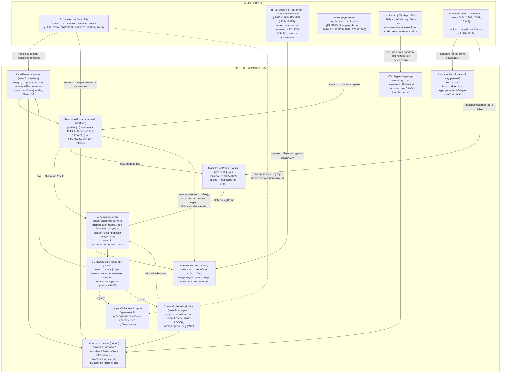

```mermaid
classDiagram
    class SchedulerInterface {
        +create(config) фабрика через SCHEDULER_REGISTRY (legacy | pair | custom)
        +schedule(tti, users) Dict — внешняя форма неизменна
        -state: SchedulerState
        -ranker: UserRanker
        -allocator: ResourceAllocator
        -multiplexing: MultiplexingPolicy (компонент QoS-пары, опционально)
        #_form_priority_list() сортировка+tie-break+top-N (остаётся)
        #validate_result() общая точка проверки результата
        #commit_plan() фаза commit экспериментального пути (v4)
    }
    class SchedulerState {
        +rr_ue_offset: int
        +rr_rbg_offset: int
    }
    class UserRanker {
        <<interface>>
        +rank(windowed_ues, views, state) prioritized_ues
        +score_candidate(ue, rbg, flow?, tti) целевая FD-форма
    }
    class ResourceAllocator {
        <<interface>>
        +prefilter(priority_list, views) List
        +allocate(tti, ues_with_pdcch, views, state) AllocationResult
    }
    class AllocationResult {
        <<value object>>
        +ue_prbs dict
        +flow_budget_bits dict or None
    }
    class CustomSchedulingPolicy {
        <<interface>>
        +propose(tti, eligible_ues, ues_with_pdcch, views, state) AllocationProposal
    }
    class MultiplexingPolicy {
        <<interface>>
        +multiplex(tti, ue, tb_bytes, buffer_statuses, flow_budgets, views) SchedulingGrant
    }
    class AllocationProposal {
        <<value object>>
        +ue_prbs dict
        +flow_budget_bits dict or None
    }
    class BestCQIRanker
    class ProportionalFairRanker
    class RoundRobinRanker
    class QosRanker
    class TDGreedyAllocator
    class RRCyclicAllocator
    class FDPerRBGAllocator
    class QosPerRBGAllocator
    UserRanker <|-- BestCQIRanker
    UserRanker <|-- ProportionalFairRanker
    UserRanker <|-- RoundRobinRanker
    UserRanker <|-- QosRanker
    ResourceAllocator <|-- TDGreedyAllocator
    ResourceAllocator <|-- RRCyclicAllocator
    ResourceAllocator <|-- FDPerRBGAllocator
    ResourceAllocator <|-- QosPerRBGAllocator
    ResourceAllocator ..> AllocationResult : возвращает
    CustomSchedulingPolicy ..> AllocationProposal : план до commit
    SchedulerInterface o-- SchedulerState : владеет
    SchedulerInterface o-- UserRanker : стратегия (путь pair)
    SchedulerInterface o-- ResourceAllocator : стратегия (путь pair)
    SchedulerInterface o-- MultiplexingPolicy : компонент QoS-пары, этап 7
    SchedulerInterface o-- CustomSchedulingPolicy : экспериментальный путь
```

**Реализовано в M1 (факт, не черновик):** узел `views-протоколы` — шесть `typing.Protocol` с `@runtime_checkable` (`CqiView` :3278, `GridView` :3296, `AmcView` :3327, `BuffersView` :3336, `StatsView` :3355, `StateView` :3376) и шесть тонких legacy-адаптеров (`LegacyCqiView` :3403, `LegacyGridView` :3424, `LegacyAmcView` :3457, `LegacyBuffersView` :3469, `LegacyStatsView` :3516, `LegacyStateView` :3557) введены в ветке `feat/SCH-008-M1-protocols` разделом в конце `SCHEDULER.py`; адаптеры делегируют существующим методам и не дублируют их (правило R5), потребители на views **не переключены** (правила R1/R2) — ни одна стрелка от оркестратора или алгоритмов к протоколам на схеме AS-IS (§1) не появилась. Целевая форма `CqiView` (`CqiEstimate`/`get_for_rbg`) и `abc.ABC`-иерархии `UserRanker`/`ResourceAllocator` в M1 не вводились: первое — CQI-трек C1 (не раньше M3), второе — шаги M4+ ([SPEC §5.3, §5.7, §8.3](specs/SPEC-FEAT-SCH-008.md)). Состав узлов и гарантии шага — [README §5](README.md) и [SPEC §4.3–4.4](specs/SPEC-FEAT-SCH-008.md).

Что изменится относительно AS-IS: общая механика аллокации (`remaining_buffer`, вызов `ALLOCATE_RBG`, сборка индексов RB, условия прерывания), продублированная сейчас в восьми `_allocate_pdsch`, уходит в иерархию `ResourceAllocator`; первоначальный порядок UE — в иерархию `UserRanker`, при этом ranker возвращает `prioritized_ues` как сейчас, а вторая сортировка, tie-break и top-N остаются в `_form_priority_list` (:684) — поведение отбора не меняется; долговременные RR-смещения (`rr_*_offset`) собираются в `SchedulerState` с правилом «один писатель на поле», `served_in_round` остаётся локальной переменной FD_FGS; переопределения оценки PDSCH становятся методом `prefilter` стратегии аллокатора (до M3 стратегии подключаются без реестра); per-flow решения QoS (`allocation_flow` :3087/:3149) переносятся в явное поле `AllocationResult.flow_budget_bits` и доходят до мультиплексирования без побочного канала, а само QoS-переопределение `_logical_channel_multiplexing` (:3175–3222) становится компонентом `MultiplexingPolicy` — необязательным четвёртым элементом дескриптора пары: оркестратор вызывает компонент из дескриптора на этапе 7 вместо `self._logical_channel_multiplexing`, внешняя форма грантов не меняется (M7b); дальнейшая эволюция QoS-мультиплексирования — карточки QoS-направления. Старые имена фабрики (`'BestCQI'`, `'FD_PF'`, `'QosAware'`, …) сохраняются через реестр с тремя видами маршрутов: `legacy` (делегирование старым классам — до переноса имени), `pair` (ranker+allocator плюс необязательный компонент мультиплексирования) и `custom` (целостная экспериментальная policy по схеме propose→validate→commit: точка запуска после этапа PDCCH, план на снимке свободных ресурсов, проверка до изменений, commit только оркестратором) — обратная совместимость с `SchedulerConfig` (SIMULATION_MANAGER.py:1044); совместимость фабрики с ядром подтверждается при интеграции, переписывания Simulation Manager не требуется. Перенос выполняется по одному алгоритму за PR (план M0–M8, v4: M4c/M4d, M5a/M5b, M8a–M8e, [specs/SPEC-FEAT-SCH-008.md](specs/SPEC-FEAT-SCH-008.md) §8) — на любом промежуточном шаге все восемь имён остаются рабочими; mock custom policy в M8e — proposal-only до реализации propose→validate→commit; синхронизация `available_algorithms()` (M8a) меняет наблюдаемый результат метода и сливается после отдельного согласования (R2). В ту же схему без изменения оркестратора встраиваются: DRL-ранжирование из ветки `feature/drl-scheduler` (PPO/DQN-ranker — как pair, либо как `CustomSchedulingPolicy`, если разложение на две стратегии искусственно) и венгерский бенчмарк ([FEAT-SCH-004](features.md#feat-sch-004) — офлайн эталонный Allocator; batch-путь `GridView.snapshot_free()/commit(plan)` — точка расширения, реализуемая после [BUG-SCH-009](audit.md#bug-sch-009)). Доступ к CQI стратегии получают через `CqiView`: на период миграции — legacy-адаптер поверх `cqi_map` с прежней семантикой WB/SB и fallback (поведение `6c0aae2` сохраняется), целевой контракт `CqiEstimate` с метками `measurement_tti`/`received_tti` и независимые политики reporting/consumption внедряются отдельным CQI-треком C1–C4; каждый алгоритм явно декларирует потребляемый набор CSI (`channel_awareness`), автоматического переключения режимов нет. Контракт без собственного rollback не отменяет [FEAT-SCH-001](features.md#feat-sch-001): откат CCE при провале PDSCH остаётся задачей оркестратора/менеджера контроля в точке отказа аллокатора.

### 3.1. Целевая раскладка пакетов проекта (обсуждается, не утверждена)

Проект переходит к модульной раскладке: отдельные папки моделей, ядра и планировщиков, при этом обсуждается вариант MAC-уровня, объединяющего планировщик и HARQ. Решение не принято, поэтому шаг M8b ([SPEC §8](specs/SPEC-FEAT-SCH-008.md)) — вынос стратегий, реестра и состояния в пакет — до фиксации раскладки не выполняется: путь пакета и маршруты импортов зависят от этого решения ([audit.md §3](audit.md), запрос в [features.md §2](features.md)).

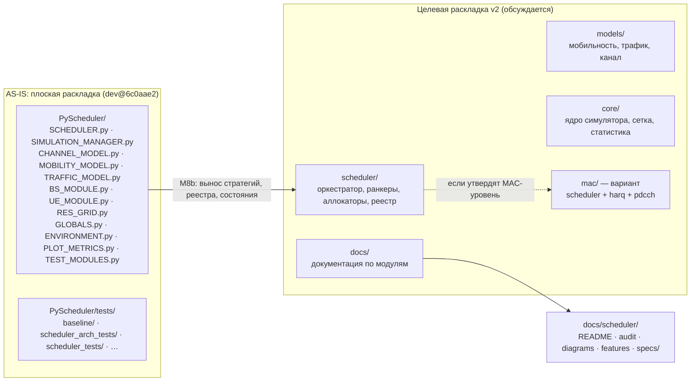

Что уже не зависит от этого решения:

- **Документация** размещается по принятому принципу «общая папка `docs/` + папка модуля»: `docs/scheduler/` с четырьмя документами и `specs/SPEC-FEAT-SCH-008.md` ([README §8](README.md)). Перенос в другую раскладку — `git mv` плюс правка относительных ссылок; внешних ресурсов в комплекте нет.
- **Код шагов M0–M7** живёт в `SCHEDULER.py` (добавления в конец файла, якоря legacy-кода не сдвигаются — [README §4.7](README.md)) и в каталогах `tests/`; на раскладку v2 это не завязано.
- **Контракты** (`AmcView`, `GridView`, `CqiView`, `BuffersView`, `StatsView`, `StateView` — :3278–3401, адаптеры :3403–3584) — точка независимости: при переезде в пакет меняются маршруты импортов, а не интерфейсы.
- **Версионирование** пакетов и релизов отложено; правило R8 (удаление legacy не ранее одного релизного цикла) до определения схемы версионирования опирается на решение владельца репозитория.

## 4. Ссылки на исходники

- `PyScheduler/SCHEDULER.py::SchedulerInterface.schedule` (:346–436) — порядок этапов 0–8, досрочные выходы через `_empty_result` (:1037)
- `PyScheduler/SCHEDULER.py::SchedulerInterface.create` (:235) — фабрика восьми алгоритмов (ключи QoS :262–263)
- `PyScheduler/SCHEDULER.py::BasicQosAwareScheduler/QosAwareScheduler` (:2704/:2960) — QoS-классы, слитые в PR #39 (`6c0aae2`)
- `PyScheduler/SCHEDULER.py::_process_buffers` (:880) — ветки отказа с `continue` (:919/:925/:944/:965) и обновление `qci_tput_tracker` (:916–919, :967–975) на `6c0aae2`
- `PyScheduler/SCHEDULER.py::_refresh_cqi` (:504, SB-часть :546) — поведение карты CQI, невалидные отчёты игнорируются
- `PyScheduler/SCHEDULER.py::PDCCHManager.allocate_cce/release_cce/reset_tti` (:1496/:1568/:1545) — учёт CCE и заглушка освобождения
- `PyScheduler/SCHEDULER.py::AdaptiveModulationAndCoding.GET_BITS_PER_RB` (:1730) — CQI → биты/RB, TODO TBS-таблиц :1749
- `PyScheduler/SIMULATION_MANAGER.py::run_tti` (:1657), создание планировщика (:1357), `SchedulerConfig` (:1030), отброшенный результат (:1451), `StatsManager` (:109, collect :158)
- `PyScheduler/UE_MODULE.py::GET_USERS_FOR_SCHEDULER` (:901–920) — контракт входа `users`, ключ `sbb_cqi` (:915)
- `PyScheduler/UE_MODULE.py::UPD_DL_THROUGHPUT_BPS` (:629, EWMA α=0.002 :644), `SINR_TO_CQI` (:693, клампит 1–15)
- `PyScheduler/BS_MODULE.py::IBufferManager` (:472; get_buffer_status :492, get_packets :507, ue_has_buffer :530), `LayeredBufferManager` (:1356), `BaseStation.use_simple_buffer` (:1696)
- `PyScheduler/RES_GRID.py::ALLOCATE_RBG/RELEASE_RBG/GET_RBG_INDICES/GET_RBG_SIZE/GENERATE_BITMAP` (:430/:440/:424/:421/:567), `BANDWIDTH_TO_RB` (:283), `RBG_SIZE_TABLE` (:293); `RELEASE_RB/RELEASE_RBG` (:399/:440) — освобождение без проверки владельца (BUG-SCH-009)
- `PyScheduler/BS_MODULE.py::QciThroughputTracker.update_all_qcis` (:223) — per-QCI throughput, точка встраивания этапа 7
- `PyScheduler/GLOBALS.py::bytes_to_bits` (:217), `BITS_PER_BYTE` (:140), `is_gbr` (:185)
- `PyScheduler/SCHEDULER.py` :3246–3584 — раздел M1 (протоколы и view-адаптеры), существует только в ветке `feat/SCH-008-M1-protocols` (коммит `f14885c`); в `dev@6c0aae2` файл заканчивается на строке 3245, поэтому якоря §1–§2 действительны в обоих случаях
- `PyScheduler/tests/baseline/` и `PyScheduler/tests/scheduler_arch_tests/` — characterization-снимки и контрактные тесты шагов M0/M1 (в `dev` отсутствуют, поставка патчами — [README §4.3–4.6](README.md))

Правила: схемы хранить **текстом Mermaid** в Markdown; AS-IS и TO-BE не смешивать; не рисовать каждую функцию; схема должна соответствовать конкретному коммиту.
